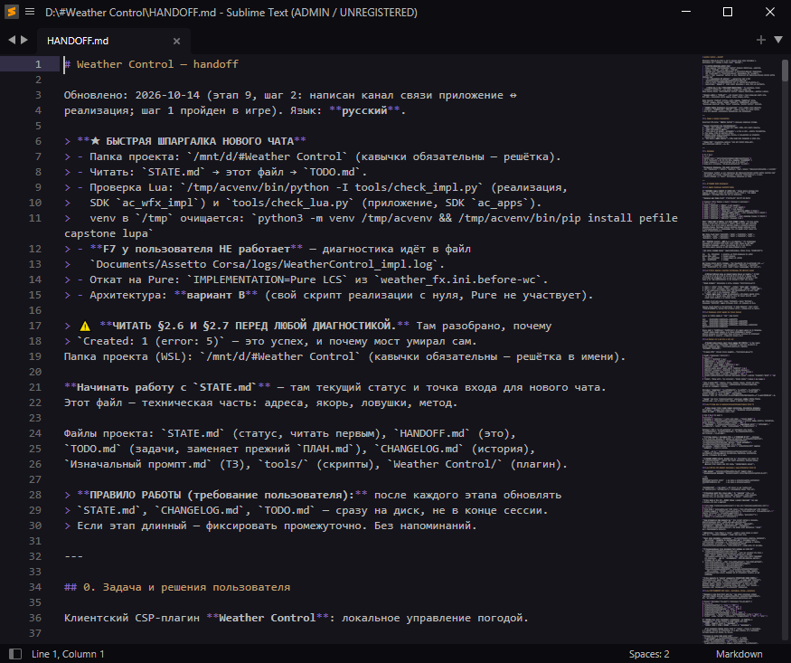

# Sublime Text

Тема Aura (soft), шрифт Consolas 10, подсветка Markdown.



## Установка одной командой

Открой PowerShell (Win+X → «Терминал») и вставь:

```powershell
irm "https://raw.githubusercontent.com/Hayden-Wright/setup/main/3.%20%D0%9A%D0%BE%D0%BD%D1%84%D0%B8%D0%B3%D0%B8/Sublime%20Text/install.ps1" -OutFile $env:TEMP\sublime-setup.ps1; & $env:TEMP\sublime-setup.ps1
```

Больше ничего делать не нужно: скрипт сам поставит Sublime Text (если его нет),
закроет запущенный редактор, сделает бэкап старых настроек, положит конфиги с
темой и поставит все пакеты. В конце напишет `Готово.`

## Что именно он делает

1. **Ищет Sublime Text.** Если не находит — ставит через `winget`.
2. **Закрывает редактор**, если тот открыт. Это обязательно: Sublime записывает
   настройки на диск при выходе и затрёт то, что мы только что положили.
   Несохранённые вкладки не пропадут — редактор восстановит их при следующем запуске.
3. **Делает бэкап** текущих `User` и `AuraTheme` в
   `%APPDATA%\Sublime Text\Packages_backup_ГГГГ-ММ-ДД_ЧЧ-ММ-СС`.
4. **Кладёт настройки**: `Preferences.sublime-settings`, `Markdown.sublime-settings`,
   `Package Control.sublime-settings` и тему `aura-theme-soft.tmTheme`.
5. **Ставит пакеты**: Package Control, MarkdownEditing, Markdown Extended.

## Как проверить, что всё получилось

Открой Sublime Text и посмотри:

- **Тема.** Фон тёмно-синий, а не серый стандартный. Если фон серый — тема не встала.
- **Markdown.** Открой любой `.md` файл: заголовки, ссылки и код должны быть
  разноцветными. Синтаксис переключается через `View` → `Syntax` → `Markdown`.
- **Пакеты.** `Ctrl+Shift+P` → набери `Install Package` — если команда есть,
  Package Control на месте.

Настройки лежат в `%APPDATA%\Sublime Text\Packages\User`. Быстро открыть эту
папку: в Sublime `Preferences` → `Browse Packages…`.

## Если что-то пошло не так

**`irm` не распознан / команда не найдена.**
Ты в старой командной строке (`cmd.exe`) вместо PowerShell. Открой именно
PowerShell: Win+X → «Терминал», или `Win+R` → `powershell`.

**«выполнение сценариев отключено в этой системе».**
Разреши запуск для текущего пользователя и повтори команду:

```powershell
Set-ExecutionPolicy -Scope CurrentUser RemoteSigned
```

**Sublime не закрылся сам.**
Закрой его вручную (сохранив что нужно) и запусти команду снова.

**Не ставится какой-то пакет** (нет интернета, упал GitHub).
Скрипт напишет `[!] ... не поставился`, но остальное поставит. Пакеты можно
добавить позже вручную: `Ctrl+Shift+P` → `Install Package` → имя пакета.

**Хочу откатить всё назад.**
Скопируй содержимое папки `Packages_backup_...` обратно в
`%APPDATA%\Sublime Text\Packages`.

## Установка из клона репозитория

Если репозиторий уже склонирован, интернет не нужен — скрипт возьмёт конфиги
из папки рядом с собой:

```powershell
cd "путь\к\setup\3. Конфиги\Sublime Text"
.\install.ps1
```

## Вручную, без скрипта

1. Поставить [Sublime Text](https://www.sublimetext.com/download).
2. `Preferences` → `Browse Packages…`.
3. Скопировать туда папки `Packages/User` и `Packages/AuraTheme` из этого репозитория.
4. Поставить [Package Control](https://packagecontrol.io/installation).
5. `Ctrl+Shift+P` → `Install Package` → **MarkdownEditing**, **Markdown Extended**.

## Полезно знать

- `Ctrl+0` — сбросить случайно увеличенный шрифт (`Ctrl+колесо`, `Ctrl+=`, `Ctrl+-`).
- Перенос строк включается в `Preferences` → `Settings`:
  `"word_wrap": true` и `"wrap_width": 0` (перенос по ширине окна).

## Файлы

| Путь | Что это |
|---|---|
| `Packages/User/Preferences.sublime-settings` | шрифт, тема, цветовая схема |
| `Packages/User/Markdown.sublime-settings` | настройки Markdown |
| `Packages/User/Package Control.sublime-settings` | список пакетов |
| `Packages/AuraTheme/aura-theme-soft.tmTheme` | тема Aura (ставится вручную, не из Package Control) |
| `install.ps1` | установщик |

Тема Aura лежит в репозитории намеренно: она не стоит из Package Control, а
подключена по пути `Packages/AuraTheme/...`. Без этого файла Sublime молча
откатится на стандартную цветовую схему.
