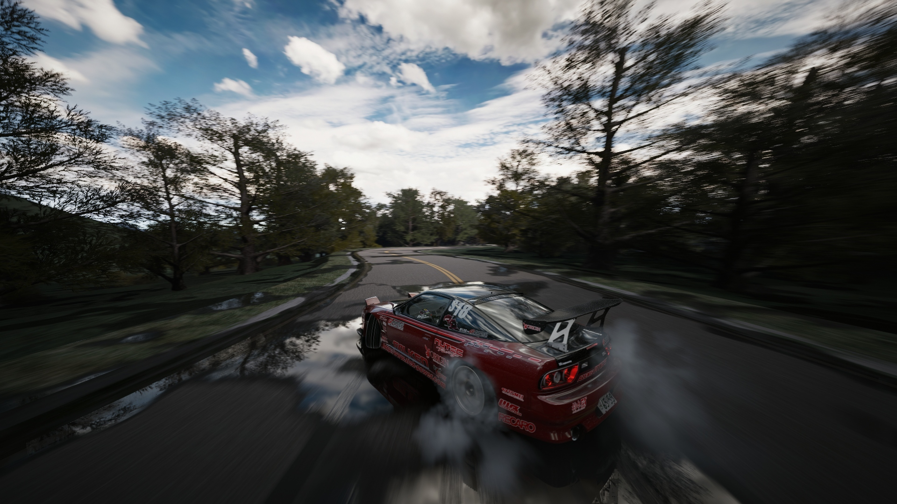
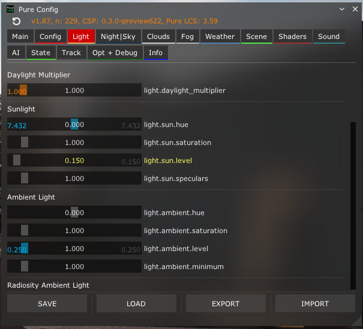
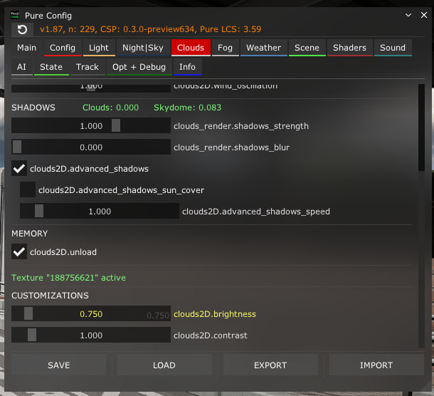
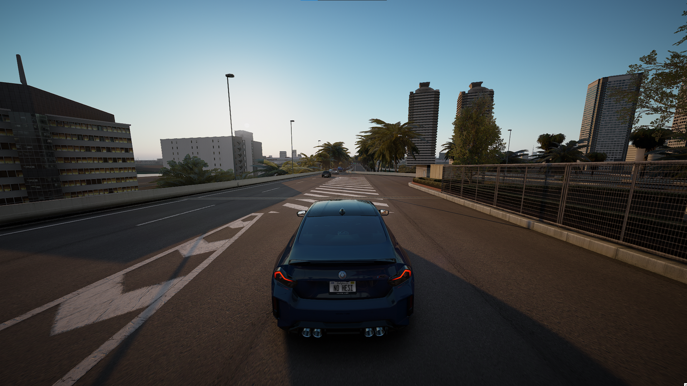

| Где | Что |
|---|---|
| **[AssettoLab](https://assettolab.ru/)** | Моды · Apps · графика |
| **[Mods Palace](https://modspalace.carcitysharing.workers.dev/assetto-corsa/mods)** | Моды · Apps · графика |

## 🖼 Графика — CDImagine

<table>
<tr>
<td></td>
<td></td>
</tr>
</table>

### Настройки

<table>
<tr>
<td></td>
<td></td>
</tr>
<tr>
<td></td>
<td></td>
</tr>
</table>

## 🎥 Chase Camera — KirbyCam

**[KirbyCam — Chaser Cam for Custom Shaders Patch](https://www.overtake.gg/downloads/kirbycam-chaser-cam-for-custom-shaders-patch.45987/)**

Конфиг — 85 FOV, NoShaking.



Заменить `camera.lua`:

```text
...\assettocorsa\extension\lua\chaser-camera\kirbycam\camera.lua
```

Готовый файл — [`kirbycam/camera.lua`](kirbycam/camera.lua). В нём
`OPT_baseFOV = 85`, `OPT_dynamicFOV = false`.

## 🕒 Убрать время / часы

Файл:

```text
...\assettocorsa\system\cfg\session_info.ini
```

```ini
PRATICE_VISIBLE=0
QUALIFY_VISIBLE=0
RACE_VISIBLE=0
```

`PRATICE` — так ключ назван в самой игре, опечатка не моя. Готовый
[`session_info.ini`](session_info.ini) можно просто заменить.

## 🚀 Чек-лист настройки AC

1. **Assetto Corsa** — запустить 1 раз
2. **Content Manager**
3. **CSP**
4. **Pure**
5. **Hotfix** — если есть
6. **Advanced Gamepad Assist**
7. **Графика** → **Apps**
