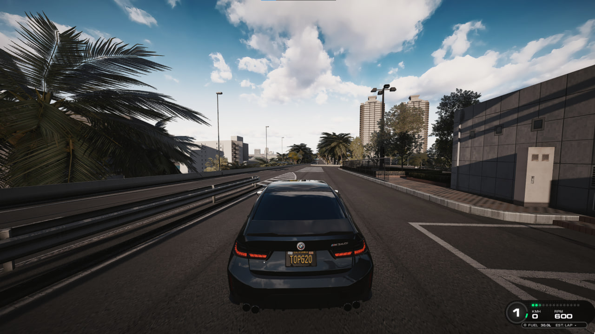
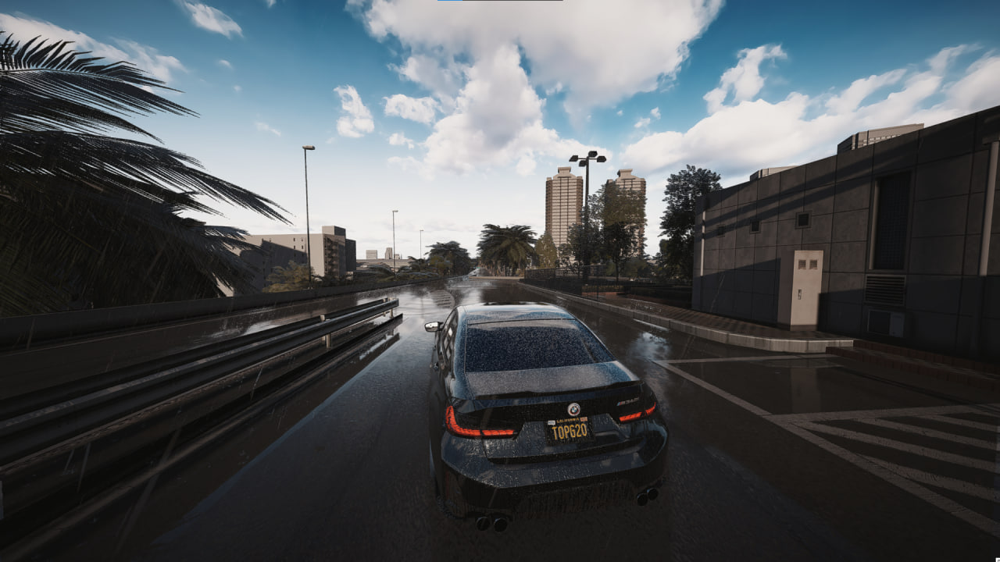

Графика, камера и HUD для Assetto Corsa. Всё ставится поверх Content Manager,
Custom Shaders Patch и Pure.

| Где | Что |
|---|---|
| **[AssettoLab](https://assettolab.ru/)** | Моды · Apps · графика |
| **[Mods Palace](https://modspalace.carcitysharing.workers.dev/assetto-corsa/mods)** | Моды · Apps · графика |

## 🖼 Графика — CDImagine

 

Значения — из Pure Config (вкладки **Light** и **Clouds**) и Pure PP
(**Script** → **Glare**). Скриншоты этих окон лежат рядом.

### Light

 

| Параметр | Значение |
|---|---|
| `light.daylight_multiplier` | 1.000 |
| `light.sun.hue` | 7.432 |
| `light.sun.saturation` | 1.000 |
| `light.sun.level` | 0.150 |
| `light.sun.speculars` | 1.000 |
| `light.ambient.hue` | 0.000 |
| `light.ambient.saturation` | 1.000 |
| `light.ambient.level` | 0.250 |
| `light.ambient.minimum` | 1.000 |
| `csp_lights.bounce` | 0.500 |
| `csp_lights.emissive` | 0.005 |
| `csp_lights.true_emissive` | 1.000 |
| `csp_lights.displays` | 0.020 |
| `csp_lights.range` | 1.000 |
| `reflections.saturation` | 1.000 |
| `reflections.level` | 1.000 |
| `reflections.sky.luminance` | 0.500 |
| `reflections.sky.saturation` | 1.000 |
| `reflections.sky.gamma` | 1.000 |

### Clouds


| Параметр | Значение |
|---|---|
| `clouds_render.shadows_strength` | 1.000 |
| `clouds_render.shadows_blur` | 0.000 |
| `clouds2D.advanced_shadows` | включено |
| `clouds2D.advanced_shadows_sun_cover` | включено |
| `clouds2D.advanced_shadows_speed` | 1.000 |
| `clouds2D.unload` | включено |
| `clouds2D.brightness` | 0.750 |
| `clouds2D.contrast` | 1.000 |
| Skykome — Clouds | 0.000 |
| Skykome — Skydome | 0.083 |

### Glare


| Параметр | Значение |
|---|---|
| Пресет | 7-Point Star |
| Godray Strength | 0.000 |
| Bloom Strength | 1.000 |
| Glare Brightness | 1.000 |
| Cast Light | 1.000 |
| Light Brightness | 0.010 |

## 🎥 Chase Camera — KirbyCam

**[KirbyCam — Chaser Cam for Custom Shaders Patch](https://www.overtake.gg/downloads/kirbycam-chaser-cam-for-custom-shaders-patch.45987/)**

Конфиг — 85 FOV, NoShaking.


Заменить `camera.lua`:

```text
...\assettocorsa\extension\lua\chaser-camera\kirbycam\camera.lua
```

Готовый файл — [`kirbycam/camera.lua`](kirbycam/camera.lua). В нём
`OPT_baseFOV = 85`, `OPT_dynamicFOV = false`.

## 🕒 Убрать время / часы

Файл:

```text
...\assettocorsa\system\cfg\session_info.ini
```

```ini
PRATICE_VISIBLE=0
QUALIFY_VISIBLE=0
RACE_VISIBLE=0
```

`PRATICE` — так ключ назван в самой игре, опечатка не моя. Готовый
[`session_info.ini`](session_info.ini) можно просто заменить.

## 🚀 Чек-лист настройки AC

1. **Assetto Corsa** — запустить 1 раз
2. **Content Manager**
3. **CSP**
4. **Pure**
5. **Hotfix** — если есть
6. **Advanced Gamepad Assist**
7. **Графика** → **Apps**
