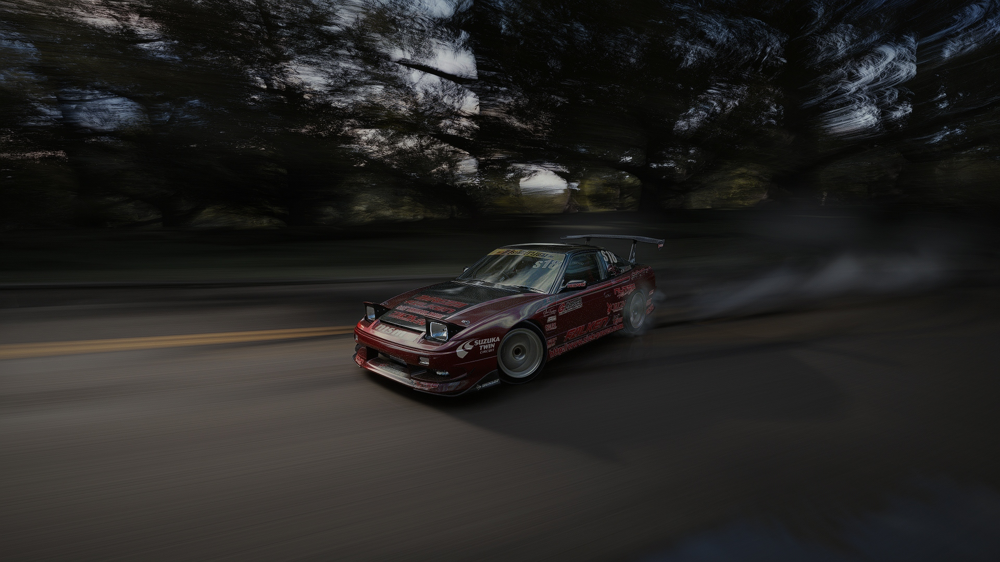
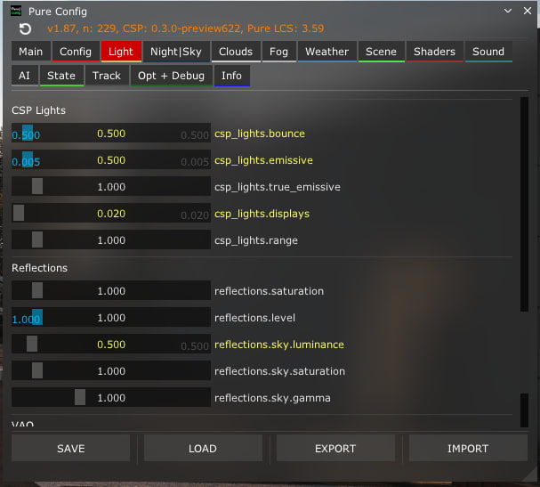
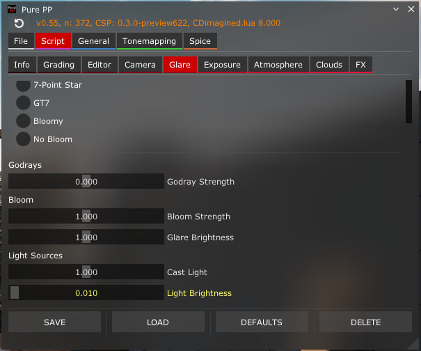
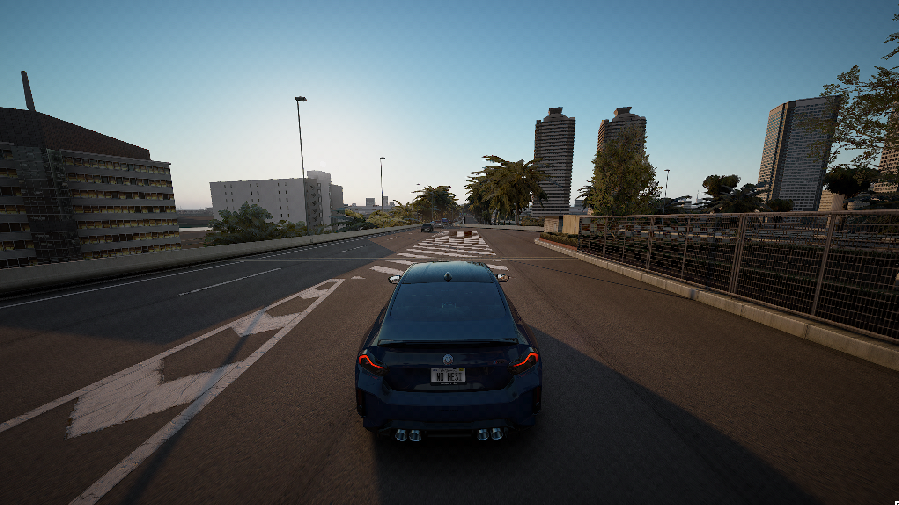

| Сайт | Что |
|---|---|
| **[AssettoLab](https://assettolab.ru/)** | CSP, Pure, apps, graphics |
| **[Mods Palace](https://modspalace.carcitysharing.workers.dev/assetto-corsa/mods)** | apps, graphics (много платных плагинов) |

##  Content Manager

<table>
<tr><td>CSP</td><td><a href="https://acstuff.ru/s/PAO3"><b>Пресет</b></a></td></tr>
<tr><td>Video</td><td><a href="https://acstuff.ru/s/2Pf"><b>Пресет</b></a></td></tr>
<tr><td>Controls</td><td><a href="https://acstuff.ru/s/LD6a"><b>Пресет</b></a></td></tr>
</table>

## 🖼 Графика — CDImagine




### Настройка CDImagine ppfilter

<table>
<tr>
<td></td>
<td></td>
</tr>
<tr>
<td></td>
<td></td>
</tr>
</table>

## 🎥 Chase Camera — KirbyCam

**[KirbyCam — Chaser Cam for Custom Shaders Patch](https://www.overtake.gg/downloads/kirbycam-chaser-cam-for-custom-shaders-patch.45987/)**

Конфиг — 85 FOV, NoShaking.



Заменить `camera.lua`:

```text
...\assettocorsa\extension\lua\chaser-camera\kirbycam\camera.lua
```

Готовый файл — [`KirbyCam/camera.lua`](KirbyCam/camera.lua). В нём
`OPT_baseFOV = 85`, `OPT_dynamicFOV = false`.

##  Advanced Gamepad Assist

**[Скачать](https://github.com/adam10603/AC-Advanced-Gamepad-Assist/releases)**

Gamepad FX скрипт для CSP. Ставится копированием папок `apps` и `extension` в
корень `assettocorsa`, включается в CM → Settings → Custom Shaders Patch →
Gamepad FX.

| Параметр | Значение |
|---|---|
| **Steering input** | |
| Steering rate | 40% |
| Steering rate at speed | +5% |
| Target slip angle | 94.1% |
| Countersteer response | 18% |
| Dynamic steering limit | 10% |
| **Self-steer force** | |
| Response | 65% |
| Max angle | 90.0° |
| Damping | 50% |

## 🕒 Убрать время / часы

Файл:

```text
...\assettocorsa\system\cfg\session_info.ini
```

```ini
PRATICE_VISIBLE=0
QUALIFY_VISIBLE=0
RACE_VISIBLE=0
```

`PRATICE` — так ключ назван в самой игре, опечатка не моя. Готовый
[`session_info.ini`](session_info.ini) можно просто заменить.

## 🚗 Убрать красные стрелки

Красные стрелки по краям экрана — индикатор машин рядом (proximity indicator).
Файл:

```text
...\assettocorsa\system\cfg\proximity_indicator.ini
```

```ini
[SETTINGS]
HIDE=1
```

`HIDE=1` — стрелки скрыты, `HIDE=0` — показываются. Готовый
[`proximity_indicator.ini`](proximity_indicator.ini) можно просто заменить.

## 🚀 Чек-лист настройки AC

1. **Assetto Corsa** — запустить 1 раз
2. **Content Manager**
3. **CSP**
4. **Pure**
5. **Hotfix** — если есть
6. **Advanced Gamepad Assist**
7. **Графика** → **Apps**
