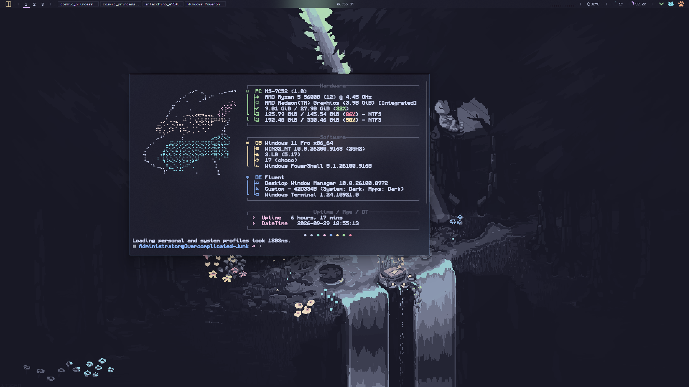

Тема Catppuccin Mocha, шрифт JetBrainsMono Nerd Font, прозрачность 80%,
при запуске — Fastfetch с ASCII-артом.



## Установка одной командой

Открой PowerShell (Win+X → «Терминал») и вставь:

```powershell
Set-ExecutionPolicy Bypass -Scope Process -Force; irm "https://raw.githubusercontent.com/Hayden-Wright/Setup/main/Configs/Windows-Terminal/install.ps1" -OutFile $env:TEMP\wt-setup.ps1; & $env:TEMP\wt-setup.ps1
```

Первая часть (`Set-ExecutionPolicy ... -Scope Process`) нужна на свежей
Windows: там политика `Restricted`, и без неё запуск скрипта падает с
«выполнение сценариев отключено в этой системе». `-Scope Process` действует
только внутри этого окна PowerShell и ничего в системе не меняет — закроешь
окно, и всё как было.

Больше ничего делать не нужно: скрипт сам поставит всё, что нужно, сделает
бэкапы и положит настройки. В конце напишет `Готово.`

## Что именно он делает

1. **Ищет Windows Terminal.** Если не находит — ставит через `winget`.
2. **Ищет шрифт** `JetBrainsMono Nerd Font` в реестре. Если нет — ставит
   пакет `DEVCOM.JetBrainsMonoNerdFont` через `winget`.
3. **Ищет Fastfetch.** Если нет — ставит пакет `Fastfetch-cli.Fastfetch`.
4. **Кладёт конфиг Fastfetch** и ASCII-арт в `%USERPROFILE%\.config\fastfetch`.
   Прежние файлы, если были, сохраняются с меткой времени.
5. **Дописывает блок в профиль PowerShell** — в тот, который уже есть на
   машине (см. ниже).
6. **Делает бэкап** текущего `settings.json` рядом с ним:
   `settings_backup_ГГГГ-ММ-ДД_ЧЧ-ММ-СС.json` — и кладёт свои настройки:
   тема Catppuccin Mocha, прозрачность 80%, шрифт, горячие клавиши.

Терминал при этом **не закрывается**. В отличие от Sublime Text, он не
перезапишет настройки при выходе — он следит за `settings.json` и
перечитывает его на лету, так что изменения видны сразу.

## Как это относится к твоим файлам

Скрипт рассчитан на то, что у тебя уже что-то настроено, и ничего не затирает.

**Профиль PowerShell.** Скрипт ищет профиль в таком порядке: тот, который он
уже правил (по метке `# >>> Setup: fastfetch >>>`), затем любой существующий,
затем создаёт новый. То есть если у тебя есть свой `profile.ps1` с алиасами —
блок допишется **в него**, а твоё содержимое останется на месте. Прежний файл
сохраняется рядом с меткой времени: `profile.ps1.backup_ГГГГ-ММ-ДД_ЧЧ-ММ-СС`.
Повторный запуск обновляет блок, а не плодит копии.

**Настройки терминала.** `settings.json` заменяется целиком (как и в гайде),
поэтому прежний сохраняется в бэкап. Если у тебя были свои профили или
цветовые схемы — их можно вернуть из бэкапа.

## Как проверить, что всё получилось

Открой **новое** окно Windows Terminal и посмотри:

- **Тема.** Фон тёмно-синий с прозрачностью, а не чёрный. Если фон чёрный —
  настройки не встали.
- **Fastfetch.** При запуске рисуется ASCII-арт и табличка с железом. Если
  её нет — см. «Если что-то пошло не так».
- **Шрифт.** `Ctrl+Shift+,` → «Открыть файл JSON»: в `font.face` должно быть
  `JetBrainsMono Nerd Font Mono`. Если Terminal не нашёл шрифт, он молча
  подставит свой — тогда поставь шрифт и перезапусти терминал.
- **Прозрачность.** Видно обои сквозь фон. Если нет — проверь, что в
  параметрах Windows включены эффекты прозрачности.

## Если что-то пошло не так

**`irm` не распознан / команда не найдена.**
Ты в старой командной строке (`cmd.exe`) вместо PowerShell. Открой именно
PowerShell: Win+X → «Терминал», или `Win+R` → `powershell`.

**«выполнение сценариев отключено в этой системе».**
Так и должно быть на свежей Windows — политика там `Restricted`. Команда в
разделе «Установка» уже снимает это на время работы окна. Если запускаешь
скрипт иначе, добавь перед ним:

```powershell
Set-ExecutionPolicy Bypass -Scope Process -Force
```

Это действует только внутри текущего окна PowerShell: закроешь его — политика
вернётся к прежней. Менять настройку навсегда (`-Scope CurrentUser`) не нужно.

**Шрифт поставился, но Terminal его не видит.**
Шрифты подхватываются при запуске приложений. Полностью закрой Terminal
(все окна) и открой заново.

**Не ставится Windows Terminal** (нет winget или Microsoft Store).
Поставь вручную: https://aka.ms/terminal

**Fastfetch не запускается при открытии терминала.**
Открой PowerShell и проверь по шагам:

```powershell
Get-Command fastfetch          # установлен ли вообще
Test-Path $PROFILE             # есть ли профиль
Select-String -Path $PROFILE -Pattern 'Setup: fastfetch'   # дописан ли блок
```

Если `fastfetch` не находится — перезапусти терминал (winget кладёт его в
`PATH`, который подхватывается при новом запуске). Если блока в профиле нет —
запусти установщик ещё раз.

**ASCII-арт не показывается, а табличка есть.**
Значит, Fastfetch не нашёл `ascii.txt`. Проверь, что файл лежит именно в
`%USERPROFILE%\.config\fastfetch\ascii.txt`, и что в `config.jsonc` в
`logo.source` стоит `~/.config/fastfetch/ascii.txt`.

**Хочу откатить всё назад.**
Настройки терминала — скопируй `settings_backup_...json` поверх
`settings.json` рядом с ним. Профиль PowerShell — так же, из
`profile.ps1.backup_...`. Конфиг Fastfetch можно просто удалить: папку
`.config\fastfetch` и блок между метками `# >>> Setup: fastfetch >>>`
и `# <<< Setup: fastfetch <<<` в профиле.

## Установка из клона репозитория

Если репозиторий уже склонирован, интернет не нужен — скрипт возьмёт
`settings.json` из папки рядом с собой:

```powershell
cd "путь\к\Setup\Configs\Windows-Terminal"
.\install.ps1
```

## Вручную, без скрипта

1. Поставить [JetBrainsMono Nerd Font](https://github.com/ryanoasis/nerd-fonts/releases/latest/download/JetBrainsMono.zip) — распаковать и установить `.ttf`.
2. В терминале `Ctrl+Shift+,` → «Открыть файл JSON».
3. Заменить содержимое на [settings.json](settings.json), сохранить.
4. Поставить [Fastfetch](https://github.com/fastfetch-cli/fastfetch/releases).
5. Создать папку `%USERPROFILE%\.config\fastfetch` и положить туда
   `Fastfetch/config.jsonc` и `Fastfetch/ascii.txt`.
6. Добавить в профиль PowerShell (`$PROFILE`) блок из `Fastfetch/profile.ps1`.

## Файлы

| Путь | Что это |
|---|---|
| `settings.json` | тема, шрифт, прозрачность, горячие клавиши |
| `Fastfetch/config.jsonc` | что показывает Fastfetch и как |
| `Fastfetch/ascii.txt` | ASCII-арт слева |
| `Fastfetch/profile.ps1` | блок для профиля PowerShell |
| `install.ps1` | установщик |
| `screenshot.png` | как это выглядит |

Конфиг Fastfetch и профиль взяты из
[Ultimate-Win11-Setup](https://github.com/SleepyCatHey/Ultimate-Win11-Setup)
(SleepyCatHey). Отличия от оригинала: путь к арту записан как
`~/.config/fastfetch/ascii.txt` вместо жёсткого имени пользователя, и убран
модуль «OS Age» — он на bash и на Windows молча не показывается.


