# Calypto’s Latency Guide

Smoother, more responsive gameplay and input

Latency is the time between a cause and an effect. An example of latency is input lag, or the time between moving your mouse and the cursor moving on the screen. A good portion of latency comes from the operating system. In this guide, I list methods to decrease input lag. This guide is mostly oriented towards gamers, but would help for any realtime application on Windows. Google is your friend if you’re not sure about something in this guide (avoid forums and Reddit). These tweaks aren’t listed in any particular order, but they are all important, otherwise I wouldn’t bother listing them. Individually, many of these tweaks probably won’t produce a perceivable difference, but if you do every single tweak you will end up with a significantly more responsive system, even if you usually can’t tell.

You’ll have to change the way you use a PC. In terms of programs, you will need a minimalistic approach. Don’t run anything in the background that you don’t absolutely need. Heavy programs such as your web browser (Spotify and Discord are reskinned Google Chrome) will slow down your system and cause stuttering. Close them before gaming and reopen them when you’re done. This goes for other programs. Windows will allocate CPU time to any service or program that is running in the background and will halt all other programs until the designated program gets its CPU time. This is how multitasking works on operating systems. If you’re curious about scheduling and multitasking, read [this](https://www.quora.com/If-there-is-only-one-processor-in-a-computer-and-if-multiple-processes-are-running-on-it-do-we-only-get-an-illusion-that-theyre-running-concurrently), or [this](https://www.tutorialspoint.com/operating_system/os_process_scheduling.htm).

## Measure your latency

Before doing anything in this guide, measure your latency using [LatencyMon](https://www.resplendence.com/latencymon) then compare after doing everything. Go to “Stats” and record your average interrupt to DPC latency, as that is what we want to decrease. You may have to restart the test a few times to get consistently low averages. The lowest possible average is reproducible, so make a mental average. Anything under .4us is good, under .3us is ideal but difficult to achieve, and impossible to achieve on Ryzen due to its architecture and limitations of Windows. When testing latency, every background program should be closed.

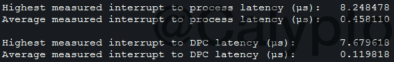

The averages are quite low. The averages are what you are looking to improve. Intel will have lower averages than AMD. Different timers (TSC/HPET/PMT etc.) will give different results.

## Measure your polling (smoothness)

The next thing you want to measure is your mouse polling using [MouseTester](https://github.com/valleyofdoom/MouseTester/releases). “Stable” polling is very hard to achieve on a system with lots of programs and services running in the background which consequently makes games run not as smoothly, so mouse polling can be used to indirectly measure the smoothness of games. When testing polling, every background program should be closed. To use MouseTester, click “Collect,” then click and hold an empty area of MouseTester while moving the mouse in fast circles. Set Plot Type to “Frequency vs. Time.” Set “Data Point Start” to a few (~150) milliseconds after you have started moving the mouse to crop off the initial polling rate ramp-up. If you do not move your mouse fast enough, it will report at a lower polling rate such as 500Hz or 250Hz when you expect 1000Hz.

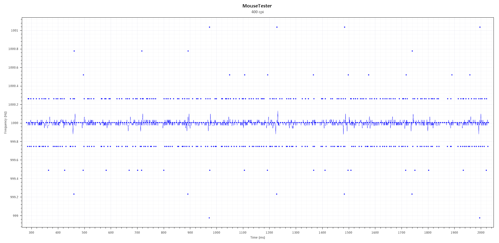

## Windows 7 vs. 8.1 vs. 10

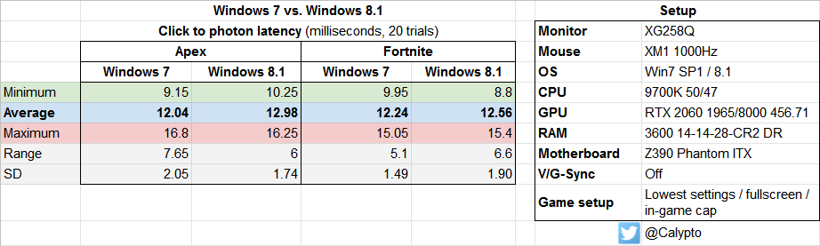

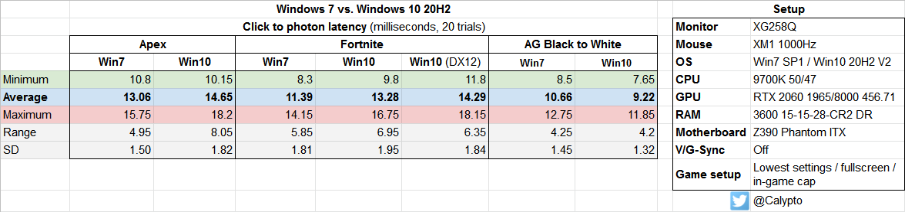

# The Tweaks:

## Disable Hyper-threading / Simultaneous Multithreading (SMT) in UEFI

This feature allows the operating system to see a physical core as two virtual cores. Although good for highly-threaded loads such as rendering or compiling, this feature massively increases the system’s latency. This is because cores only have one execution unit, which is exacerbated by the operating system attempting to spread the load across both virtual processors of the same core, which creates a stall while the core’s execution unit is busy with the second logical processor.

It is ideal to simply disable HT/SMT if you have more cores than your game requires, or force the game to run on separate cores by changing the affinity to every other logical processor in Task Manager or Process Lasso (example: CPUs 1,3,5,7+ or 0,2,4,6+ etc.). If you have eight or more cores, you can safely turn it off for almost all games. If you have six or fewer cores, you might be forced to leave it on and change the affinity of the game to prevent contention between the logical CPUs. Another benefit to disabling SMT is lower power consumption, which raises overclocking headroom.

- [Latency test of HT on vs. off](https://twitter.com/CaIypto/status/1437352870979018752)

## Disable processor idle states

By disabling idle, you can force your processor to run at max clocks if you have a locked CPU that doesn't support overclocking (mostly Intel non-K SKUs). If you have a static all-core overclock then you can skip this step, but your CPU will only be running at C1 and not C0 which is the state where the CPU is fully responsive. This will minimize jitter and latency caused by your CPU constantly switching clocks and C-states. Disabling idle makes your processor run very warm, so ensure you have adequate cooling. Do not disable idle if you have SMT/HT enabled as Windows sleeps the other logical processor of a core to prevent contention. On Windows 10, CPU usage will show as 100% in Task Manager.

1. Run CMD as admin:
2. powercfg -attributes SUB_PROCESSOR 5d76a2ca-e8c0-402f-a133-2158492d58ad -ATTRIB_HIDE
3. Open power management options in Control Panel, set your plan to "Maximum Performance", open the power plan, go to advanced settings, then set “Processor idle disable” to “Disable idle” under processor power options.

- Power saving has no place on a gaming machine
- I’ve listed the commands below which you can paste into .bat files and run from your desktop if you don’t want your CPU running at C0 all the time:

Disable idle: (more responsive, higher temperature/power usage)

```
powercfg -setacvalueindex scheme_current sub_processor 5d76a2ca-e8c0-402f-a133-2158492d58ad 1
powercfg -setactive scheme_current
```

Enable idle: (less responsive, lower temperature/power usage [Windows default])

```
powercfg -setacvalueindex scheme_current sub_processor 5d76a2ca-e8c0-402f-a133-2158492d58ad 0
powercfg -setactive scheme_current
```

## Device Manager

Open Device Manager (devmgmt.msc) and disable anything you’re not using. Be careful not to disable something you use. Uninstalling a driver via Device Manager will most likely result in it reinstalling after reboot. In order to completely disable a driver, you must disable it instead of uninstalling. When you disable something in Device Manager, the driver is unloaded. Drivers interrupt the CPU, halting everything until the driver gets CPU time (some drivers are poorly programmed and can cause the system to halt for a very long time [stuttering]). What to disable:

Display adapters:

- Intel graphics (if you don’t use it, ideally should be disabled in the BIOS)

Network adapters:

- All WAN miniports
- Microsoft ISATAP Adapter

Storage controllers:

- Microsoft iSCSI Initiator

System devices:

- Composite Bus Enumerator
- Intel Management Engine / AMD PSP
- Intel SPI (flash) Controller
- Microsoft GS Wavetable Synth
- Microsoft Virtual Drive Enumerator (if not using virtual drives)
- NDIS Virtual Network Adapter Enumerator
- Remote Desktop Device Redirector Bus
- SMBus
- System speaker
- Terminal Server Mouse/Keyboard drivers
- UMBus
- In the “Properties” window, be sure to disable “ [Power Management](https://i.imgur.com/hMWA9Xv.png) ” for devices such as USB root hubs, network controllers, etc.

Now click on View→Devices by connection

1. Expand PCI bus, then expand all the PCI Express Root Ports
2. Locate PCI Express standard Upstream Switch Port and disable every single one with nothing connected to it (if you have it)
3. Locate Standard AHCI 1.0 Serial ATA Controller, disable any channel with nothing connected to it
4. Disable the High Definition Audio Controller that’s on the same PCIe port as your video card, also the USB controller
5. Disable any USB controllers or hubs with nothing connected to them
1. For your mouse and keyboard, disable any “HID-compliant device,” these devices are used for your mouse/keyboard software but you don’t need them always running (if your mouse disconnects, you can use your keyboard to re-enable them)
1. Disable any PCI Express Root Port with nothing connected to it (they are usually empty NVMe or PCIe ports)

- Here is an example of someone’s device manager to give you a better idea: https://i.imgur.com/9sdzhbl.png

## Disable unnecessary services

Most gaming computers will never be connected to a printer, yet the printer service is always enabled, wasting CPU cycles and forcing context switches. The same goes for other services. Keep in mind you may run into issues with too many services disabled, so make a backup of your default service configuration by using the script below, and vice versa after disabling the services. Drivers can also be disabled (the ones not shown in Device Manager), but doing so involves a high risk of making your system unbootable, so have a form of backup ready like another Windows partition to [edit the registry offline](https://adamtheautomator.com/offline-registry-editor/). Keep track of every driver you’ve disabled and its original start type. [Serviwin](https://www.nirsoft.net/utils/serviwin.html) allows you to easily view and manage drivers and services.

- Service backup script (if you get an error, ensure WMI service is enabled): https://www.winhelponline.com/blog/backup-windows-services-configuration/

The easiest way to disable services is through services.msc. Services can also be disabled via the registry if you run into a permissions issue using services.msc. In regedit, navigate to:

```
HKEY_LOCAL_MACHINE\SYSTEM\CurrentControlSet\services
```

From there, you can change the start type:

0 = Boot (driver)

1 = System (driver)

2 = Automatic

3 = Manual

4 = Disabled

Another way to disable services via the registry is simply with a .reg file. Use the “Properties” box in services.msc to get the name of the service, then create a .reg file with entries such as:

Windows Registry Editor Version 5.00

[HKEY_LOCAL_MACHINE\SYSTEM\CurrentControlSet\Services\BluetoothUserService]

"Start"=dword:00000004

[HKEY_LOCAL_MACHINE\SYSTEM\CurrentControlSet\Services\Spooler]

"Start"=dword:00000004

If you get an error when trying to run the .reg, use [PowerRun](https://www.sordum.org/downloads/?power-run) (some services require the TrustedInstaller privilege in order to be modified, such as Windefend or wuauserv).

DHCP Client, Network Connections, Network List Service, Network Location Awareness, and Network Store Interface Service are required to automatically connect to a local network, but once a static IP is set, they can be disabled. See below to setup static IP:

- Open Network and Sharing Center → Change adapter settings → right click, properties → IPv4 properties → open cmd and type “ipconfig” and fill out the settings as such: https://i.imgur.com/o1PGS2E.png
- If you’re still confused, see this tutorial on how to set a static IP: https://pureinfotech.com/set-static-ip-address-windows-10/
- Network Store Interface Service may be required on Windows 10 for dogshit programs that determine whether or not you’re connected to the Internet such as Apex Legends
- System Events Broker is required for Radeon Software to open on Windows 10

Example service configs:

- Windows 7: https://i.imgur.com/ftNhfrV.png / [bare services](https://i.imgur.com/B61QF92.png)
- Windows 10 1709: https://i.imgur.com/VsX7AtP.png
- Windows 10 21H2: https://i.imgur.com/5nXdaYg.png

## Disable your antivirus

Antivirus causes stuttering and unnecessary CPU usage. Instead, scan files before running them and do frequent system scans. Don’t visit shady websites, and don’t browse the Web without an ad or script blocker ([uBlock](https://github.com/gorhill/uBlock), [uMatrix](https://github.com/gorhill/uMatrix), [ηMatrix](https://addons.palemoon.org/addon/ematrix/) [Pale Moon only]). By default Windows uses Defender, which takes a few steps to disable:

- On Windows 7, disable the Windows Defender service
- On Windows 10:

1. Search for “Virus & threat protection,” click “Manage settings,” then disable Real time protection
2. Using [PowerRun](https://www.sordum.org/downloads/?power-run) , run this .reg file to disable Windows Defender-related services (including Firewall): [DisableDefender.reg](https://drive.google.com/file/d/1RS341BFehQOg4AeVlCVFO59mtYWsXJf2/view?usp=sharing)

## Disable optional features

By default, Windows comes with many optional features that you may never use. Disable everything that you don’t need.

- Press “Windows key+R” → type “optionalfeatures” and press enter
- Windows 7 example image: https://i.imgur.com/96DKRJD.png

## Startup

Prevent useless bloat such as Discord/Realtek/Steam/RGB/mouse/keyboard software etc. from starting up with Windows. Your PC will start up faster, and once started will run fewer unnecessary programs.

1. Press “Windows key+R” → type “msconfig” → go to the “Startup” tab
2. Uncheck everything unless you absolutely need it. Launch it manually instead.

Disable DWM (Windows 7 or lower)

This disables desktop composition which is quite irritating if you want better responsiveness outside of games, or are playing games not in exclusive fullscreen.

1. Right click on the desktop
2. Personalize
3. Select “Windows Classic”
4. Disable the “Desktop Window Manager” and “Themes” services

## Windows 10 Specific

- [Disable VBS/HVCI](https://www.tomshardware.com/how-to/disable-vbs-windows-11) (Windows 10/11)
- Under “Exploit Protection” (use search), disable all the mitigations (obviously this will reduce system security so use caution)
- Disable fast startup (Control panel → Power Options → Choose what the power buttons do → uncheck “Turn on fast startup”)
- Replace the start menu with [OpenShell](https://github.com/Open-Shell/Open-Shell-Menu) ; OpenShell is faster/lighter than the M$ start menu
- Add .old to StartMenuExperienceHost.exe and SearchApp.exe in C:\Windows\SystemApps to prevent the Win10 start menu from running
- If you want a Windows7-like configuration, import this [.xml](https://drive.google.com/file/d/1STrXuONXPkjkc-cJ42Z52FRBGDDOaf5f/view?usp=sharing) to OpenShell by pressing “Backup” in OpenShell settings (right-click start button)

Disable Spectre and Meltdown protection / other mitigations (Windows 10/11 or updated 7/8)

- https://www.grc.com/inspectre.htm
- [Example image](https://i.imgur.com/zR1Gz7M.png) of what it should look like when you disable mitigations
- [Disable Downfall](https://betanews.com/2023/08/28/microsoft-reveals-how-to-mitigate-the-downfall-vulnerability-affecting-intel-processors-running-windows-10-and-windows-11/)
- If you installed [KB5029778](https://support.microsoft.com/en-us/topic/kb5029778-how-to-manage-the-vulnerability-associated-with-cve-2022-40982-d461157c-0411-4a91-9fc5-9b29e0fe2782) (on or after August 22, 2023), you must disable Downfall which is enabled by default

## Disable power saving features

There are numerous CPU-level bugs that can’t quite be fixed with microcode related to power-saving features. To ensure maximum stability, disable any power-saving features in the BIOS. Keep in mind your CPU will be using more energy due to no power saving which means more heat. Disable these:

- Any P states besides P0
- C states
- AMD Cool&Quiet / Intel SpeedStep (manually overclock your processor instead)

## Disable the Steam browser

Download and install https://github.com/Aetopia/NoSteamWebHelper, this will prevent the webhelper processes from constantly running in the background.

## Power Plan

By default, Windows uses the “Balanced” power plan which attempts to save energy when possible. Instead, set the plan to “High Performance” in Control Panel→Power Options or even make a custom power plan using [PowerSettingsExplorer](https://forums.guru3d.com/threads/windows-power-plan-settings-explorer-utility.416058/). The default “High Performance” plan still has many energy-saving features enabled which is why it is better to create a custom plan. On W10 1803+ you may enable the “Ultimate Performance” power plan which is a slight step above the regular “High Performance” plan by pasting this command into CMD as admin:

```
powercfg -duplicatescheme e9a42b02-d5df-448d-aa00-03f14749eb61
```

## Enable MSI mode for drivers

Some drivers default to using legacy pin-triggered interrupts, which are now emulated and are slower than using MSI (message-signaled interrupts). Enabling MSI for a driver that does not support it might break your Windows. If something goes wrong, you can recover with last known settings (f8) or by [editing the registry offline](http://smallvoid.com/article/winnt-offline-registry-edit.html).

- To enable MSI mode for drivers, [download MSI_util_v2](https://forums.guru3d.com/threads/windows-line-based-vs-message-signaled-based-interrupts.378044/) , run as admin , then select your graphics card, audio controllers, PCIe ports. On Windows 7, do not enable it for the default EHCI, SATA controller driver, or anything you’re not sure of . These drivers do not support MSI and will prevent your system from booting. However, third party (vendor) EHCI/AHCI drivers may support MSI.
- You can check the Device Instance Path (the address listed on the bottom) in Device Manager by right-clicking a device, going to Properties, Details, Device Instance Path
- Priorities usually hurt more than helps
- Every time you update a driver you have to redo the steps for the updated driver
- Only devices with IRQs will benefit, seen under Device Manager → View → Resources by Connection

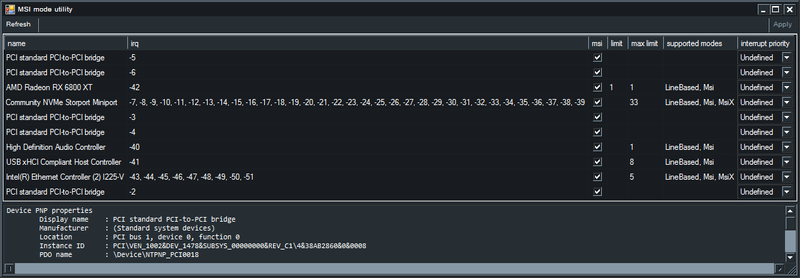

## Alleviate IRQ sharing

If devices are sharing IRQs (interrupt request lines), they will interfere with each other and increase interrupt latency. To prevent IRQ sharing, enable MSI (see above section) for each driver that supports it and double check that you don’t have interrupt sharing. If you still have devices sharing an IRQ, consider disabling them, moving them to a different PCIe slot, or entirely disabling them.

- Device Manager → View → Resources by connection → expand “Interrupt request (IRQ)”

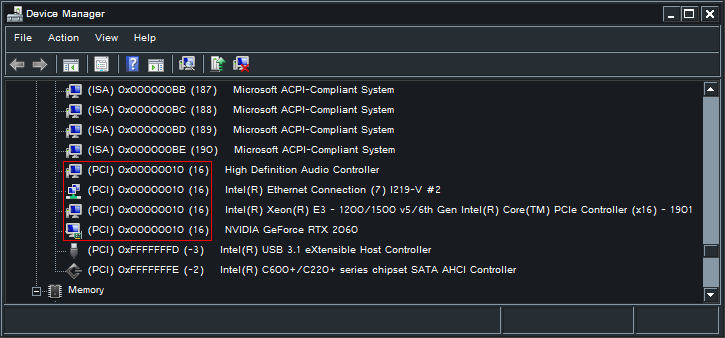

Example of IRQ sharing - four devices share IRQ 16 which will cause interrupts from these devices to compete with each other

## How to properly install NVIDIA drivers

The Nvidia driver executable installs a lot of bloat. Use NVSlimmer to select what you need (enable NvContainer [Nvidia control panel]). Click apply before installing.

Continuation project of NVSlimmer:

- https://forums.guru3d.com/threads/nvslimmer-nvidia-driver-slimming-utility-continued.457504/

Original version by uKER (no longer works with newer drivers):

- https://forums.guru3d.com/threads/nvidia-driver-slimming-utility.423072/

If you have a Windows install without Microsoft Store and need the control panel installed, you can get it here: https://github.com/Matishzz/DCH-ControlPanel

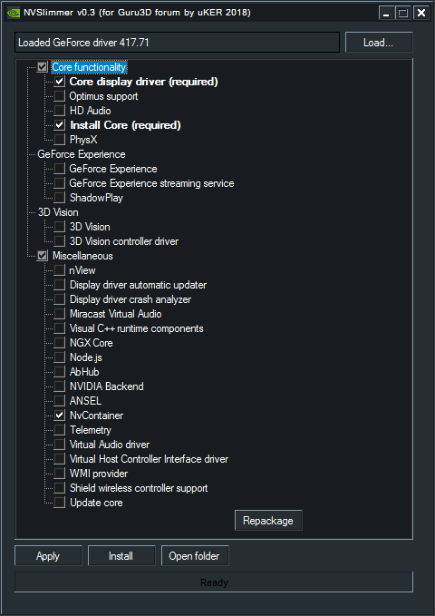

## Nvidia 3D settings

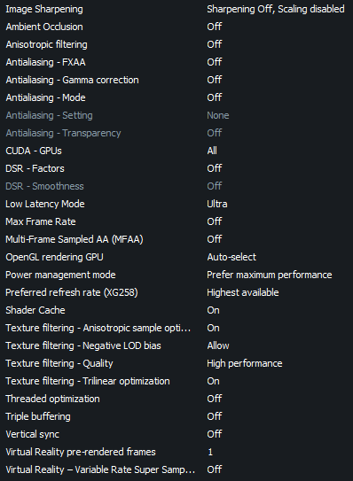

- [Low Latency Mode](https://i.imgur.com/tmTJDAQ.png) should be set to “On” instead of “Ultra” if you experience low smoothness or stuttering
- Make sure there are no per-game override settings such as “Image Sharpening” enabled (Apex Legends for example has it enabled by default, despite the global setting)
- Under “Change Resolution,” use display scaling if available, uncheck override scaling mode

No longer recommended; use “Prefer maximum performance” in Nvidia Control Panel which works properly and still allows the GPU to downclock when idle.

Lock GPU clocks (Nvidia only, see the section below for Radeon cards)

This tweak forces the GPU to always run at boost clocks. This prevents the GPU from constantly switching back and forth between different clock speeds which will negatively impact performance. Ensure you have adequate load temperatures (<70°C) or you will shorten the lifespan of your card. Note that starting with Nvidia 1000 series cards, you cannot completely lock clocks. The core clock will fluctuate based on load, temperature, or power usage.

In regedit, navigate to the path below and create a dword as such (if you have multiple GPUs installed in your system, the 0000 may be 0001, 0002, etc.):

[HKEY_LOCAL_MACHINE\SYSTEM\CurrentControlSet\Control\Class\{4d36e968-e325-11ce-bfc1-08002be10318}\0000]

"DisableDynamicPstate"=dword:00000001

- Read more here: https://github.com/djdallmann/GamingPCSetup/blob/master/CONTENT/RESEARCH/WINDRIVERS/README.md
- See Cancerogeno’s guide “ [A slightly better way to overclock and tweak your Nvidia GPU](https://docs.google.com/document/d/14ma-_Os3rNzio85yBemD-YSpF_1z75mZJz1UdzmW8GE/) ” which explains how to properly lock clocks on modern Nvidia GPUs

## AMD GPUs

Radeon Software settings:

- Graphics tab (see this [image](https://i.imgur.com/JuObgh5.png) for all graphics settings):
- Radeon Super Resolution: Off
- AMD Fluid Motion Frames: Off
- Radeon Anti-Lag: Off
- Radeon Boost: Off
- Radeon Chill: Off
- Radeon Image Sharpening: Off
- Radeon Enhanced Sync: Off
- Wait for Vertical Refresh: Off
- Everything else: Off / Lowest
- Display tab:
- AMD FreeSync: Optional - increases latency in exchange for less tearing
- Virtual Super Resolution: Off
- GPU Scaling: Off (unless your monitor doesn’t have scaling support)
- Display Color Enhancement: Off

For RDNA 1-2 only, RDNA 3 (7xxx) has locked PowerPlay tables

Download and install [MorePowerTool](https://www.igorslab.de/en/download-area-new-version-of-morepowertool-mpt-and-final-release-of-redbioseditor-rbe/); this section will massively help with stuttering caused by power saving and downclocking. This tool allows you to change certain VBIOS values without having to flash the GPU’s BIOS; instead they are read from the Registry, meaning you can easily change or revert them if something is wrong.

- Use [GPU-Z](https://www.techpowerup.com/download/techpowerup-gpu-z/) to dump your current VBIOS - see [this picture](https://i.imgur.com/1lz9Fog.png) if you can’t find the button
- Open MorePowerTool, then use the VBIOS you dumped from GPU-Z to load the Power Play Tables to edit the settings below
- Features
- [Feature Control](https://i.imgur.com/McTcj6v.png) (5xxx)
- [Feature Control](https://i.imgur.com/B9SKVHJ.png) (6xxx)
- Power:
- You can slightly raise the GPU’s power limit but this is not an overclocking guide so be extremely conservative unless you know what you are doing, see [here](https://www-hardwareluxx-de.translate.goog/community/threads/navi-21-max-overclocking-tutorial-6800-xt-6900-xt.1300245/?_x_tr_sl=de&_x_tr_tl=en&_x_tr_hl=en&_x_tr_pto=sc#post-28512632) for more info on overclocking
- [Frequency](https://i.imgur.com/fNHuUTK.png) : Set reasonable minimum frequencies for SoC and Fclk (1100 and 1800 are good starting values for 6xxx, respectively)
- Setting these too high will result in instability which will cause microstuttering, stuttering, or crashing
- Ensure your GPU’s cooler is adequate to run these frequencies 24/7, otherwise your GPU will quickly degrade
- Dcefclk must remain at its default value
- Leave the default GFX frequencies in MorePowerTool and set min/max using MoreClockTool below instead, as you will get microstuttering if GFX MPT min. freq. > MCT min. freq.
- Fan: Disable “Zero RPM Enable”; this will increase stability and performance in game, while also increasing the lifetime of your card
- Additionally, set a custom fan curve using MoreClockTool below to further prevent degradation from ridiculous default fan curves
- Once finished, click “Write SPPT” and restart the GPU driver or reboot
- Use [HWiNFO](https://www.hwinfo.com/download/) to make sure minimum frequencies were applied. If your GPU is still downclocking below the minimum you set, it means you have to start over and figure out which clock was set too high (the driver will use default SPPT values if a bad value was set)
- If you’re satisfied with the values you’ve set, click “Save” so you can apply these changes whenever you update drivers as it deletes the SPPT (Soft Power Play Table)

Download and install [MoreClockTool 1.0.1](https://www.igorslab.de/en/download-area-new-version-of-morepowertool-mpt-and-final-release-of-redbioseditor-rbe/); you change a few other performance-related settings through this tool which is faster than using Radeon Software. If you haven’t already, change the fan curve because stock fan curves are generally extremely relaxed for the high level of heat that GPUs output (the VRAM and other components on the PCB get cooked due to inadequate airflow from stock curves or zero RPM mode). Your fan curve should be at 100% at 80°C or lower. One thing to keep note of, depending on your cooler and the type of load, the hotspot temperature can be over 30°C higher than the “GPU” temperature, which can cause rapid degradation if not kept in check (e.g. 60°C GPU, 90°C hotspot).

- Set your desired minimum and maximum frequencies here. Unlike in the Radeon control panel, you can set the minimum/maximum frequencies to be equal
- Every time the system crashes (regardless of whether the GPU was at fault) you have redo everything, so saving the settings to a file will save some time
- Windows 7: If you get an error when clicking “Set” then you need to change your performance tuning profile to “Custom” in Radeon Software

Remove Radeon-related bloatware:

- AMD Crash Defender (rename amdfender.sys to amdfender.sys.old in C:\Windows\System32\drivers)
- Device Manager:
- High Definition Audio Controller (the one from your GPU) - uninstall and delete driver software if the device keeps enabling itself
- AMD-Dynamic Audio Noise “Supression”
- AMD Link Controller Emulation
- AMD Radeon USB3.1 Host Controller
- AMD Special Tools Driver (not installed by default, required to flash BIOS)
- AMD Streaming Audio Device
- AMD UCM-UCSI Device
- Services:
- AMD Crash Defender
- AMD External Events Utility (required for FreeSync to work)
- On Windows 7, Radeon Software (the control panel) requires the Aero theme in order to not crash, but it should be disabled once you’ve dialed the settings in
- Fullscreen games require Desktop Window Manager and Themes services and Aero theme if using more than one monitor
- Fix for ["Do you want to change the color scheme to improve performance?"](https://superuser.com/a/1194286) on Windows 7

Optional: Disable DX11 NAVI for RDNA 1/2 (RX 5xxx, 6xxx): https://nimez-dxswitch.pages.dev/NzDXSwitch. This fixes stuttering/microstuttering in DX11 games caused by recent DX11 “optimizations” added in 22.5.2 for RDNA 2 and 23.7.2 for RDNA 1. However, average FPS will tank as a result of disabling these optimizations. Only do this if you know what you are doing.

- Follow the instructions in the link above; use the third column to disable DX11 NAVI (“DX9 NAVI with Regular DX11”)
- GPU driver restart required; every driver update you must do this again so the program below will save you some time
- If you are confused, you can use this GUI program instead: https://github.com/cbk0313/Radeon-DX-Configurator

Radeon Anti-Lag 2 offers a measurable reduction in latency; however, do not expect a massive difference.

- [Counter-Strike 2 latency test results for Anti-Lag 2](https://x.com/CaIypto/status/1821382755600482725)

## Interrupt affinity

Using Microsoft’s [Interrupt-Affinity Policy Tool](http://download.microsoft.com/download/9/2/0/9200a84d-6c21-4226-9922-57ef1dae939e/interrupt_affinity_policy_tool.msi) ([backup link](https://drive.google.com/open?id=1_XHjXsWJOIoC5nu07bYQ-5padFQ5CQWI)), you can set affinity for a driver’s interrupts. Do not go overboard as you can make the system perform worse if you randomly start changing affinities. Ideally each device should have its own core, or left alone if you have already dedicated your most important devices to every available core.

- Changing the interrupt affinity of some drivers may prevent you from booting. If this is the case, use recovery mode to boot from last known good configuration
- Default install dir: “C:\Program Files (x86)\Microsoft Corporation\Interrupt Affinity Policy Tool” (use the x64 executable)

1. Install [Interrupt-Affinity Policy Tool](https://drive.google.com/open?id=1_XHjXsWJOIoC5nu07bYQ-5padFQ5CQWI) , then run as admin
2. Open Device Manager and click “View”→”Devices by connection.” Then expand all devices, as you will need this to see which devices are connected to which port/bridge
1. If you open the properties of the device, it will show the location “PCI bus #, device #, function #,” you will need this in case multiple devices share the same name (e.g. two xHCI controllers, both named “USB xHCI Compliant Host Controller”)
1. Select a driver and click “Set Mask” (this is for IrqPolicySpecifiedProcessors )
1. Select the core you want the driver to be executed on
2. If you have HT or SMT, use only one SMT sibling (i.e. CPUs 0/1 are SMT siblings, only use 0 or 1 but not both)
3. Press the “Advanced…” button for other choices (not useful unless you have drivers that use MSI-X or you have a multi-socket system)
4. Do not restart drivers for storage devices or root ports with storage devices attached, restart your PC instead to prevent risk of data corruption
5. Use xperf to see if the affinities have been set properly, see below for xperf script

Non MSI-X drivers perform best when affinity is set to a single core (IrqPolicySpecifiedProcessors). If a device uses MSI-X, it will use IRQPolicySpreadMessagesAcrossAllCores by design, regardless of what affinity you set it to use. If you want to force an MSI-X device to a specific core, you must set its message limit to 1 via MSI Util. Every time you update a driver (such as your GPU driver) you will have to set the affinity again. Examples of devices to change:

- GPU
- Setting the graphics card onto a single core gives the best performance, however setting it to a busy core will result in worse performance. You will have to find out which core performs best by benchmarking, such as using menu FPS or something very consistent with high FPS (500+) that you can reproduce easily. Usually it is the last core.
- USB controllers (xHCI/EHCI)
- Audio controllers (does not apply to usbaudio devices, change USB controller interrupt affinity instead)
- Network controller
- When using RSS, set to IrqPolicySpreadMessagesAcrossAllProcessors. You will also need to change RssBaseCpu, as interrupts will always land on the RssBaseCpu first, then each consecutive CPU (depending on how many RSS CPUs). You can change RssBaseCpu via the GUI from Device Manager under your network adapter’s properties. If the setting is unavailable then create a dword using regedit called “RssBaseCpu'' under HKEY_LOCAL_MACHINE\SYSTEM\CurrentControlSet\Services\Ndis\Parameters, then enter the number for the corresponding CPU (e.g. 3)

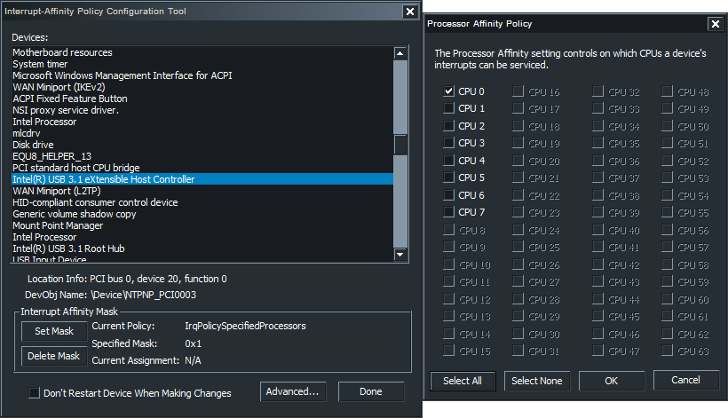

## Benchmarking affinities or driver latency

- [MouseTester](https://github.com/valleyofdoom/MouseTester/releases) for benchmarking xHCI/EHCI controller affinities
- [liblava-demo](https://github.com/liblava/liblava/releases/) for benchmarking GPU affinities, or anything else with extremely high FPS
- Use [CapFrameX](https://www.capframex.com/) or something similar to benchmark average FPS, 1% and .1% lows
- [Xperf](https://docs.microsoft.com/en-us/windows-hardware/get-started/adk-install) for benchmarking execution latencies for each driver. A script will make using it very easy
- My simple [batch script](https://github.com/Calypto/xperf-dpcisr-script/blob/master/README.md) which includes a Windows 7 download link without having to install all of ADK
- [Timecard's script](https://github.com/djdallmann/GamingPCSetup/blob/master/CONTENT/SCRIPTS/xperfdpcisr.ps1) which uses PowerShell if you prefer that instead
- Permon (Ctrl+R) allows you to see DPCs and interrupts per core
- Go to “Performance Monitor” → click the green “+” sign → Processor → select DPC Rate, DPCs Queued/sec, Interrupts/sec → <All instances> → press “Add > >” then “OK” → Change to “Report” view
- Run the game or program that you normally would and move perfmon to another monitor to see DPC/interrupt activity in realtime

## Automatically setting process affinities and priorities

If you don’t use SMT/HT or have E-cores, you can skip this step. If you have SMT/HT/E-cores enabled, Process Lasso is a useful program to automatically set CPU affinities for better performance in games. You don’t have to use this specific software; anything else that manages affinities persistently will work.

- Download and install: https://bitsum.com/get-lasso-pro/
- Launch your game, right click on the .exe, press “CPU Affinity,” “Always,” then select every other CPU if using SMT/HT ( [example here](https://i.imgur.com/40QTOgF.png) ). If you use E-cores, set the affinity to only the P-cores.
- For games with anti-cheats that prevent setting affinities, you will have to set the launcher’s affinity so the game will automatically inherit the affinity. Example: set Epic Games Launcher’s affinity, then Fortnite will automatically receive the same affinity from the launcher
- You can also use the “ [CPU Sets](https://bitsum.com/product-update/process-lasso-10-4-cpu-sets-and-adler-lake/) ” feature which isn’t blocked by EAC, however it’s a soft affinity which means your game can still potentially run on logical processors you didn’t select, read the article above for more details

Other options for Process Lasso:

1. Press the Options menu, go to General , Configure Startup . For the first box select “Do not start at login”, the second box select “Start at login for ALL users,” press Next, “Manage ALL processes Process Lasso has access to”, click finish. This will ensure only ProcessGovernor.exe (the service) runs at login, which will set the priorities of processes automatically.
2. Press the Options menu, go to General Settings , Refresh interval (governor) , select 10s. This will minimize CPU usage of the Governor process.
3. Disable ProBalance, IdleSaver, and SmartTrim under the “Main” menu since they are unnecessary for gaming
4. Feel free to explore the other options, however they may cause more harm than good. You don’t want the user interface (ProcessLasso.exe) running all the time, only ProcessGovernor.exe.

## Reserved CPU Sets

Starting with Windows 10 21H2, you can reserve CPUs to prevent Windows from scheduling work to them. This can be useful to minimize context switching for latency-sensitive programs such as games. Use at your discretion; if you do not have a sufficient number of cores (ideally 12+ cores, or E-cores), then do not bother with this setting as you are likely to degrade system performance. Modern games can easily utilize 6+ cores which leaves you with very little breathing room if you have an 8 core CPU. Keep in mind this setting can still be overridden by very heavy workloads (i.e. a program that can fully utilize every single logical processor, such as a stress test).

1. Download and run: https://github.com/valleyofdoom/ReservedCpuSets
2. Select the logical processors which you want Windows to isolate (in other words, select the processors which Windows will ignore)
3. Reboot for the setting to take effect
1. If the setting took effect, then Windows should be scheduling work specifically to the cores which you did not select using the tool above. You can verify this by running a stress test such as Prime95 and choosing n-1 threads (if you have 16 cores, select 15 threads, otherwise it will run on all cores as mentioned above). In the case of a 13700K which has 8 P-cores and 8 E-cores, if you isolated the first 8 cores which are the P-cores then Windows should be scheduling to the last 8 cores which are E-cores
1. Change the affinity of the programs/drivers of which you want to run on the reserved cores
1. To change the affinity of programs, use [Process Explorer](https://learn.microsoft.com/en-us/sysinternals/downloads/process-explorer) or Process Lasso, [Interrupt Affinity Tool](https://drive.google.com/open?id=1_XHjXsWJOIoC5nu07bYQ-5padFQ5CQWI) for drivers
2. Again, verify the setting took effect by checking per-core CPU usage using [HWiNFO](https://www.hwinfo.com/download/) / [HWMonitor](https://www.cpuid.com/softwares/hwmonitor.html) /Xperf
1. To revert the changes, uncheck all CPUs in ReservedCpuSets

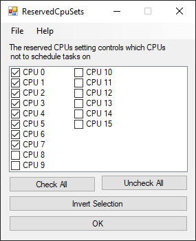

Lower Latency Hardware (centered around gaming, not professional tasks such as low latency audio)

Disclosure: I receive a commission through these Amazon product links at no cost to you.

CPUs:

For optimal smoothness in gaming, an 8-core CPU is the minimum. 6-core CPUs are obsolete and will not be able to smoothly run modern games at high frame rates.

In regards to CPUs with no iGPU (i.e. “KF”), it is cheaper to have it and not need it, than to need it and not have it. The iGPU can be used for video encoding or as a backup GPU in case the main GPU were to stop working. In most cases you are only saving ~$15 so it makes little sense to give up such significant functionality. Also, ensure your CPU’s frequency is locked across all cores to minimize latency and jitter from constant clock switching.

i7-3770K (4C/8T)

- Outdated for modern games; however, the L2 hit latency is 10ns lower than Skylake-based CPUs (~10ns vs. ~20ns)
- Uses DDR3 which is lower latency than DDR4 due to DDR4’s grouped banks and timing limits on Skylake (ex. tRCDtRP, 28 tRAS, 16 tFAW)

Disable E-cores on 12th generation CPUs (Alder lake) through UEFI as they massively limit overclocking potential of the Uncore (ring). Disabling E-cores typically yields an Uncore increase from ~4.2GHz to ~4.7GHz. You can see a benchmark of how the 12900K performs with various core/HT configurations [here](https://kingfaris.co.uk/blog/12900k-core-configs/intro). In games, the best performance comes from disabling Hyper-Threading and E-cores in the case of Alder lake.

[i7-12700K](https://amzn.to/3qz43Wq) (8P/4E)

- Still a viable option if you need 8 P-cores for $100 less than the 13700K, but beware of the limitations of this architecture compared to its successors (much lower P-core and E-core clocks, and the aforementioned issue of Uncore frequency with E-cores enabled)

Raptor Lake is similar to Alder Lake, with the exception of larger caches (from 8x1.25MB to 8x2MB L2 on the P-cores and from 2MB to 4MB L2 per each E-core cluster) and efficiency improvements which yield much higher P and E-core clocks. Unlike Alder Lake, the Raptor Lake E-cores do not have a parasitic effect on the uncore clock. Typically in games, E-cores off will result in the lowest average latency, but you may see better frame time consistency with the E-cores enabled. Raptor Lake Refresh (14th gen.) brings marginally higher clocks and [APO](https://www.intel.com/content/www/us/en/support/articles/000095419/processors.html) but is otherwise the same architecture. As always, do not run stock clocks, especially on 13th or 14th generation CPUs as they use extremely high voltage values in the V/F curve which will result in degradation. Use fixed clocks and voltage instead.

[i7-14700K](https://amzn.to/48sF9wf) (8P/12E)

- Four more E-cores over the 13700K for ~$30 more, buy the 14700K over the 13700K unless it is unreasonably more expensive

[i9-13900K](https://amzn.to/3DMMr0X)/[14900K](https://amzn.to/43dJMbW) (8P/16E)

- Comes at a large premium over the 13700K/14700K but offers higher overclocking potential and more L3 cache (from 30MB/33MB, respectively, to 36MB)

With Intel’s latest desktop architecture Arrow Lake (Core Ultra 2xx) being non-monolithic, there were latency regressions in numerous domains, with a massive hit to RAM latency and a smaller hit to core-to-core latency due to the E-core clusters being sandwiched between the P-cores. As such, its performance is lackluster in anything that isn’t purely single-threaded bound. AMD has made numerous improvements over the previous generation with its 9000 series X3D processors; the most important change being the SRAM die (“X3D”) having been flipped with the CCD die, allowing for much better thermal dissipation compared to previous generations. As such, AMD has finally unlocked the multipliers on X3D chips, allowing for all-core overclocks (and consequently allowing static clocks across all cores).

[9800X3D](https://amzn.to/4fX5RRf) (8C)

- Very solid pick if you do not want to worry about scheduling issues with the dual-CCD 9950X3D, but 8 cores is rather limiting with how bloated software as a whole has become

[9950X3D](https://amzn.to/4iVUutU) (8+8C)

- Comes with an additional CCD (eight more cores) which can be utilized as E-cores to offload background bloatware off of the X3D die to minimize context switching. However, the separate die requires careful planning (and testing) with scheduling due to the cross-CCD latency penalty. As such, it is not a “just works” solution, and is not recommended if you are not willing to test

CPU Cooling:

As with any other electronic component, the electrical losses are lower the better they are cooled, resulting in better efficiency. Therefore it’s important to have a strong cooler for the CPU, as the IHS and small die size massively limit cooling performance. AIOs offer better cooling performance than air coolers because the radiators have higher fin density and the warm air can be directly exhausted out of the case. Another benefit to having water cooling is the ability to mount a RAM fan due to the free space from not having a tower cooler.

Motherboards:

Cheap motherboards will not allow your hardware to run at its full potential; RAM overclocking is highly dependent on the motherboard, and to a lesser extent CPU overclocking as well, therefore it is important to be selective when choosing one. Motherboards can be judged by hardware design; things like PCB layout and trace design, PCB layer count, VRM design, heatsinks, etc. all play a massive role in quality. On the software side, the firmware is also critical to RAM overclocking. A poorly optimized firmware will not take advantage of the (hopefully) good hardware.

Motherboards with 2 DIMM slots such as mini-ITX will have higher RAM overclocking potential than boards with 4 DIMM slots due to shorter distance from the CPU. 2 DIMM ATX boards will cost more compared to mini-ITX boards, but have much stronger VRMs. Mini-ITX motherboards also have a large drawback: the RAM is right next to the GPU which emits a lot of heat. Even if you do not plan on drawing high current, extra EPS connectors help provide more stable power for the CPU’s VRM via lower resistance. Gigabyte motherboards lack user addressable IOL/RTL settings, which can very negatively impact RAM latency. Intel Z390 is the last generation to have T-topology motherboards for 4 DIMM overclocking (vs. the daisy chain layout, which suffers when 4 DIMMs are present). One extremely useful feature to consider is BIOS flashback, as it allows you to flash your BIOS without having to turn the system on. In the case of a failed BIOS flash, flashback should allow you to recover, especially with the newer WSON8 packages (previously SOIC8) where using external programmers with clips is nearly impossible. Flashback should also allow you to bypass downgrade and modded BIOS restrictions.

Z490:

Asus Z490i

- Reportedly better RAM OC than MSI Z490i, but much weaker VRM
- 8 layer PCB

MSI Z490i Unify

- Requires firmware updates for CR1 support
- 10 layer PCB
- Direct phase design

MSI Z490 Unify ATX

- 6 layer PCB, decent value for quad rank, ample VRM but uses doublers

Asus Z490 XII Apex

- Only 6 layer PCB, 2 DIMM slots

EVGA Z490 Dark

- Windows XP support
- 10 layer PCB, 2 DIMM slots
- Direct phase design, can disable LLC

Z590:

Avoid the Z590 Gigabyte Aorus Elite/Pro due to faulty power plane design

MSI Z590 Unify-X: $270

- 8 layer PCB, 2 DIMM slots
- 16+2+1 “mirrored” VRM

ASRock Z590 OC Formula: $480

- 12 layer PCB, 2 DIMM slots
- Missing “Hidden OC Item” making the UEFI nearly useless

Asus Z590 XIII Apex: $500

- 10 layer PCB, 2 DIMM slots
- Has new “ [Vlatch](https://www.elmorlabs.com/index.php/2021-03-30/rog-maximus-xiii-apex-rog-vlatch-tested-with-oscilloscope/) ” feature which can detect and report minimum and maximum Vcore voltages through HWInfo

Gigabyte Z590 Tachyon: $530

- 8 layer PCB, 2 DIMM slots
- Direct phase design

EVGA Z590 Dark: $600

- 10 layer PCB, 2 DIMM slots
- Direct phase design, can disable LLC

Z790: If using Windows 7 and motherboard audio, beware of the Realtek ALC4080 audio chip present on most higher-end boards as there is no W7 driver. Older Z790 motherboards will require BIOS flashback to support 14th gen. CPUs. Be sure to get an aftermarket ILM (independent loading mechanism) since the stock ILM causes warpage resulting in very poor thermal performance:

- igor’sLAB: [German Engineered Bend Aids for Intels LGA1700 – Thermal Grizzly CPU Contact Frame and Alphacool Apex Backplate Thermal Testing | Review](https://www.igorslab.de/en/german-engineered-bend-aids-for-intels-lga1700-thermal-grizzly-cpu-contact-frame-and-alphacool-apex-backplate-thermal-testing/)
- Gamer’sNexus: [$4.35 Fix for Intel Thermal Problems | Thermalright 12th Gen Contact Frame](https://www.youtube.com/watch?v=iYU1OskbY-Q)
- [Thermalright Contact Frame](https://amzn.to/45TThwx) : $8.59

[MSI Z790 Tomahawk DDR4](https://amzn.to/3XZvVSX): $210

- 6 layer PCB, 8 phase twin design
- Same PCB as the more expensive Z790 Edge but without the RGB
- Requires [BIOS 1.6+](https://www.msi.com/Motherboard/MAG-Z790-TOMAHAWK-WIFI-DDR4/support) or your uncore ratio will be stuck at 45x

[Gigabyte Z790 Aorus Elite X AX DDR5](https://amzn.to/3HQ2qfR): $240

- 8 layer PCB, 8+1 twin phase design
- Affordable DDR5 board with decent RAM overclocking potential and BIOS flashback, but appears to have QC issues based on reviews, so exercise caution
- The “X” denotes Z790 refresh; do not buy the non-”X” boards as they are the much worse older version with a 6 layer PCB

[Asus Z790-A Strix DDR4](https://amzn.to/3jlApV9): $265

- 6 layer PCB, unknown phase design
- Support for LGA 1200 coolers (additional mounting holes)

[Asus Z790 Apex Encore](https://amzn.to/3Mndjsq): $650

- 8? layer PCB, 12 phase teamed design
- Higher RAM frequency potential than the Z790 Dark, which was completely abandoned by EVGA
- [Z490/Z590 Motherboard Spreadsheet](https://docs.google.com/spreadsheets/d/16YJm4L1-ohpL8s-4rLDDDCBZvi97ZYwkc44s7LS5-2Q/)
- Contains detailed information such as PCB layer count, Vcore / Vccgt / Vccsa / Vccio VRM specs, among other things
- [Z590 VRM List](https://docs.google.com/spreadsheets/d/1_ZGSXi1deJEXhHZNcm3bGvP-r8KkNKKPdTuBoFPctH4/edit#gid=0)
- Contains basic VRM and IO information
- [Z690 Motherboard Roundup](https://www.overclock.net/threads/official-intel-z690-motherboard-roundup-ocn-edition.1794800/)
- Includes VRM information as well as general features like clear CMOS, input/output, etc.
- [Z690/Z790 Motherboard Spreadsheet](https://docs.google.com/spreadsheets/d/1gQI4K-Wn7orr6m7tqCdy02Tbdpd4neXXRh_jXnMf2jY/edit#gid=1463929059)
- Contains detailed information such as PCB layer count, Vcore / Vccgt / Vccsa / Vccaux VRM specs, among other things
- [AM5 Motherboards Sheet](https://docs.google.com/spreadsheets/d/1NQHkDEcgDPm34Mns3C93K6SJoBnua-x9O-y_6hv8sPs/edit?gid=2064683589#gid=2064683589)
- Includes VRM, audio codec+DAC, networking, I/O, among other things
- [der8auer: Doubler vs. Twin: In depth VRM dive - feat. special AMD Threadripper Emulator](https://www.youtube.com/watch?v=Y4-78_a33Fo)
- Explanation of Direct vs. teamed (twin) vs. doubled VRM, with oscilloscope shots of Vcore
- Summary: Direct > teamed > doubled, all else equal

Z890/AM5 motherboards:

- https://rentry.co/mbrg

RAM:

Having fast and stable RAM can dramatically decrease system latency since numerous games and programs heavily depend on RAM to feed the CPU with data (anything that is not immediately on the CPU must be retrieved from RAM, which is orders of magnitude slower than the CPU). By default on most systems, DDR4 RAM is clocked at 2133 15-15-15, which is extremely slow compared to something easily attainable like 3600 15-15-15 with tuned subtings and any decent Samsung B-die RAM kit, and on recent platforms like Z390/X570 and up. Here you can see some benchmarks of what results are possible just by overclocking RAM:

- [Impact of RAM speed on Intel's Skylake desktop architecture](https://kingfaris.co.uk/blog/intel-ram-oc-impact/fortnite) by KingFaris
- [A benchmark I did a while ago](https://twitter.com/CaIypto/status/1342699275428323330)

Built-in overclocking profiles like XMP/DOCP/EOCP can be toggled for better performance, however they are still overclocks and thus do not guarantee stability. On top of that, the profiles do not include subtimings, meaning there is still a large amount of performance left on the table. Therefore, it’s a good idea to learn how to overclock the RAM yourself to ensure it is running at its full potential and is stable. You can reference this guide to learn more:

- [DDR4 OC Guide](https://github.com/integralfx/MemTestHelper/blob/oc-guide/DDR4%20OC%20Guide.md) by integralfx

When overclocking anything (CPU/GPU/RAM, etc.) it is important to ensure the overclock is stable and temperatures are controlled. Higher temperatures result in lower stability which can lead to errors that result in data corruption and/or crashes. Thus it is critical when stress testing, that you use multiple stress tests (not at once) for multiple hours to guarantee stability. An unstable overclock that does not immediately appear to be unstable can also have devastating effects. It can result in constant error-correction which in games can lead to inconsistent frame times which will be perceived as low smoothness/microstuttering. It is nearly impossible to pinpoint such an issue unless you recognize your system is overclocked (such as with XMP), as stress tests rarely pick up this type of instability. Another thing to keep note of is heat from other components such as the CPU/GPU can heat up your RAM which will lead to instability. Removing case panels can help mitigate this issue, but heat will still build up without proper airflow. A RAM fan is a must when overclocking. Any 140mm fan will do, but it must be securely mounted to blow directly onto the DIMMs, otherwise the effectiveness will be little to nothing.

RGB on RAM is detrimental to performance due to the additional traces and components required for the LEDs. This will increase power draw which will in turn increase heat and electrical noise which will both interfere with RAM operation, all while driving up cost to you. In terms of DDR4 DRAM voltage, anything under 1.5-1.6V is “safe” for daily use, but around these voltages the RAM will quickly be thermally limited, even with a fan. The metallic covers on DIMMs are only there for aesthetic and safety purposes to prevent accidental damage from user error. These covers can be removed for better thermals since they use low quality thermal tape (or just glue) and cover the [back of the PCB with foam](https://i.imgur.com/7KvbxTv.jpg) spacers which make the RAM run hotter than if the “heatsinks” weren’t there in the first place. The temperature sensors present on DIMMs are located on the [Serial Presence Detect](https://www.ablic.com/en/semicon/wp-content/uploads/2019/05/DIM_Web-top.png) (SPD) chip and do not report the actual junction temperatures of the dies. In reality the memory is probably overheating when the temperature sensor is reporting only 40C, which is the ambient air immediate to the DIMMs. All else equal, dual-rank RAM performs better than single-rank RAM. This is because the data is more evenly spread out across different banks, meaning the memory controller is less likely to run into a bank that is busy refreshing. However, more ranks require more voltage for the same timings and require a high quality motherboard for better signal integrity. There is also more heat being produced which requires more powerful cooling. Since manufacturers do not state whether their DIMMs are dual rank or not, the only way to really determine if you’re buying dual rank is to know what chips are being used. In the case of Samsung B-die, a dual rank kit will be 2x16GB since a single rank B-die kit is 2x8GB.

If your hardware allows for it, make sure the “command rate” timing (in your BIOS/UEFI) is set to 1. CR2 (command rate 2) is the default setting on most motherboards since it is easier to guarantee stability. However, there is a latency penalty when using CR2 since the memory controller will skip X (1, 2, …) cycles before issuing commands to the RAM chips. However, stabilizing command rate 1 requires a very high quality motherboard, a good IMC (integrated memory controller), and good RAM (Samsung B-die for DDR4). On top of that, if you have an 11th or 12th gen. Intel CPU, ensure your memory controller is set to “gear 1.” Gear 2 incurs a large latency penalty since the memory controller is running at half the memory’s frequency. 11th gen. CPU IMCs typically cap with RAM around 3600 MT/s in gear 1, while 12th gen. typically caps around 4000 MT/s with some leeway offered if Vccsa is increased. Ryzen CPUs are similar in that the Mclk and Fclk need to be 1:1, otherwise you incur a large latency penalty just like 11/12th gen. Intel CPUs. Zen 3 will cap around 3733 MT/s. Both command rate and gear settings are also dependent on the load on the memory controller. Tighter timings, higher frequency, additional ranks, additional DIMMs, and additional channels (if applicable) all add stress to the memory controller, with the latter being the heaviest loads. Therefore it is important to recognize what your limiting factors are.

The “best” consumer DDR4 RAM die in most cases is Samsung 8Gb B-die, as it scales well with voltage allowing for lower timings. Beware of A0 PCB kits which are usually older (2017-2018). This older PCB layout is less ideal due to the chips being farther away from the DIMM’s pins. The A2 layout is generally better, and is found in recently released kits. Listed below are typical B-die timings, but do not guarantee Samsung B-die. Use these as base timings; higher price does not guarantee a better bin. Keep in mind many of the kits in these lists have RGB which is detrimental to performance. If you find two kits with similar timings but dissimilar voltage, the lower voltage kit could imply a better bin.

- [3200 14-14-14-XX](https://pcpartpicker.com/products/memory/#S=3200&L=30,140&sort=price&page=1)
- 3600 14-14-14-XX
- 3600 14-15-15-XX
- 3600 15-15-15-XX
- 3600 16-16-16-XX
- 4000 14-15-15-XX
- 4000 15-16-16-XX
- 4000 16-16-16-XX
- 4000 17-17-17-XX
- XTREEM / Viper Steel lack temperature sensors
- [Image comparison](https://i.imgur.com/rFRDe0M.jpg) of A0/A1/A2/A3 PCBs ( [Source](https://www.facebook.com/photo.php?fbid=1517832921732388&set=pb.100005170833640.-2207520000..&type=3) )

For DDR5, the “best” RAM dies are either [16Gb Hynix A-die](https://amzn.to/3TVHv1P), or [24Gb Hynix M-die](https://amzn.to/3IllaV4), both being relatively equal in overclocking potential. The kits linked are cheaper examples that will still guarantee the respective dies, but will require manual tuning to achieve good performance (as is the case with any other XMP profile, but more so here). 10ns first word latency at >6000MT/s is typically Hynix [16Gb A-die](https://pcpartpicker.com/products/memory/#b=ddr5&sort=price&S=6000,8400&F=6000000,10000000&Z=32768002) or [24Gb M-die](https://pcpartpicker.com/products/memory/#b=ddr5&Z=49152002&sort=price&S=6000,8400&F=6000000,10000000).

Since DDR5 requires gear 2 on Intel, the only way to realistically reduce latency is to run as high a memory clock as possible to attempt to offset the increased latency floor. This means running only one rank (and/or DIMM) per channel as the frequency penalty offsets the performance increase of running multiple ranks. Another “gotcha” is that DDR5 has on-die ECC, which increases margins for manufacturers by allowing them to sell otherwise garbage chips, therefore stress testing becomes much more difficult as the RAM could be silently correcting errors and thus giving a false sense of stability. A proxy to check for error correction is running a stress test such as [y-cruncher](http://www.numberworld.org/y-cruncher/) (specifically FFT/N63/VT3) which lists the performance of each run. Large variation between runs could indicate error correction.

GPUs:

At low settings, the CPU and RAM are more important than the GPU for high refresh rate gaming. You want a stable foundation (CPU and RAM) before buying a GPU, so a modern (13700K+) overclocked eight-core CPU is the minimum for driving high refresh rates. Avoid buying blower cards (one fan), avoid overly cheap cards (usually bad cooler or power delivery), and be wary of problems brought up in reviews. Avoid AMD GPUs due to their bad drivers and no overclocking support starting with 7000+ series. If you have a Radeon 6000 or Nvidia 3000 or newer series card, consider enabling Resizable BAR as it may help with performance. See [this article](https://www.guru3d.com/review/pcie-resizable-bar-performance-amd-and-nvidia-benchmarks/) for more information about requirements and how to enable Resizable BAR, as well as benchmarks. If you have an Nvidia GPU, consider enabling Reflex if your game has the option to reduce latency from higher GPU load. Use “On” instead of “On+Boost” as the latter results in worse performance. Manually lock the GPU clock instead. Only buy Nvidia GPUs because Radeon drivers have unacceptable performance when CPU bound, cheat FPS by forcing prerendered frames, and mislead users by using [Total Graphics Power instead of Total Board Power](https://www.igorslab.de/en/graphics-cards-and-their-consumption-read-out-rather-than-measured-why-this-is-easy-with-nvidia-and-nearly-impossible-with-amd/4/) in software power readings which is roughly 30% lower than TBP.

Beware that recent Nvidia GPUs (4xxx and 5xxx) have cut down core counts relative to the flagship GPU compared to what was historically offered on 3xxx series GPUs and earlier. Therefore, in order for you to see an actual performance uplift over your older GPU, you have to spend much more money. From https://old.reddit.com/r/pcgaming/comments/1gzu0az/blackwell_update_historical_analysis_of_nvidia/:

- “... the rumored gap between 5080 and 5090 is EVEN LARGER. The 5080 is rumored to have 10752 cores, which is only 43.8% of the cores of the top die. This puts the 5080 at the same "cut down level", or to say, it is as cut down as a 4070 Ti was when compared to its top die. If we go back to Ampere, the 5080 is as cut down as a 3060 Ti was compared to the top Ampere die (!!!!!).”
- “The 5070 Ti has 36.5% of the cores of the top Blackwell die. In past generations, getting roughly 33-36% of the top die was something that the 960 (33.3%), 1060 6GB (also 33.3%) and 3060 (also 33.3%) cards achieved. This means that the 5070 Ti is almost as cut down as previous generations xx60 cards.
- “The RTX 5070 is 26% of the full die, putting it in the range of previous generations RTX 4060 Ti (which was already a big disappointment as per my original post, at 23.6% of its top die) and brace for it... the 5070 seems to be almost as cut down as an RTX 3050 (23.8%).”

RTX 5070 Ti / 5080 / 5090

- Only the 5090 has a noticeable performance uplift over the 4090 (only +25%), the rest of the cards are essentially the same performance
- 5xxx series finally have UHBR20 DisplayPort connectors, which are important if you plan on using high refresh rates/resolutions to avoid having to use Display Stream Compression (DSC) to make up for the lack of bandwidth the outdated DP 1.4a connectors had, which has numerous annoying issues such as slow alt-tab times, broken multiplane overlays, etc.
- First Nvidia generation to use hardware flip metering
- No Windows 7 drivers; Nvidia 3xxx was the last generation to support Windows 7
- [Latency comparison of various upscaling methods in Overwatch 2 (RSR, FSR 1.0 & 2.2)](https://twitter.com/CaIypto/status/1763029473794916556)
- Despite the GPU usage still being relatively low, there is a rather large reduction in latency from using upscaling. If your game has DLSS/FSR, consider trying it to see how it affects your GPU usage and image quality as it may be a worthy trade-off, especially if you have a high refresh target (360 FPS+) or underpowered GPU.

Storage:

Random accesses are generally what regular usage involves (i.e. gaming, desktop usage), so choosing an SSD with low latency and high RND4K read speeds is important. [NVMe SSDs have much lower latency than SATA SSDs](https://www.kingston.com/unitedstates/en/community/articledetail/articleid/48543). HDDs should be avoided unless absolutely necessary as they are inherently slow; they take longer to turn on and seek files, while making extra noise (acoustic and EMI) and using a lot of energy to do so. Most M.2 ports interface through the chipset instead of directly to the CPU. While this isn’t terrible, there is obviously a latency penalty. Since Zen 1 and Intel 11th gen., motherboards have at least a single x4 M.2 slot that interfaces directly with the CPU instead of PCH, so if applicable, use those ports for higher performance. One thing to keep in mind is that higher capacity SSDs typically have higher performance and endurance ratings, so note this when choosing which size to buy (500GB, 1TB, 2TB, etc.). When looking at SSD reviews, any reviewer that doesn’t list system specifications or isn’t using a platform newer than Intel 12th gen. Or Ryzen 7000 should be disregarded, as CPU performance massively dictates SSD performance (if the reviewer has the Samsung 980 Pro in a comparison and isn’t getting >95MB/s 4KQ1T1 in CDM, that’s a massive red flag). Do not buy DRAM-less SSDs as they have higher latency and lower endurance. Non-monolithic CPUs have deteriorated SSD performance as seen on Zen and Arrow Lake CPUs, so if SSD performance is critical above all else then Raptor Lake is the fastest choice.

From the software side, the operating system and storage drivers also play an important role in SSD speed. The generic NVMe driver that comes with Windows generally performs worse than manufacturer drivers such as Samsung’s1. Ensure your drive never thermal throttles and has some form of cooling (heatsink, fan, or both). For optimal SSD response, the CPU should be running at a fixed frequency across all cores with SMT disabled, ASPM and C-states disabled from UEFI, and idle disabled in power plan settings.

1. Use the modded Samsung NVMe driver from [Fernando](https://winraid.level1techs.com/t/recommended-ahci-raid-and-nvme-drivers/28310) (modded to work with non-Samsung drives):

- Download: [Windows 7](https://mega.nz/#!00pVkQLJ!NqJwjtrr_pRhyjaUB4jXXbxbgvhCaB62uGFGUfVOxek) , [Windows 10](https://mega.nz/#!FwgHHYTT!4-DRoYjvUsDusDUWG5xZMifSETtL1zG7TZ1SuF9Zs7w)

SSD benchmark tools:

- [ATTO Disk Benchmark](https://www.techpowerup.com/download/atto-disk-benchmark/)
- [CrystalDiskMark](https://crystalmark.info/en/software/crystaldiskmark/) (set profile to “Real World Performance” - use this program if you are unsure of which to get from this list)
- [Iometer](http://www.iometer.org/)
- [KDiskMark](https://github.com/JonMagon/KDiskMark) (GNU/Linux)
- [PCH vs. CPU PCIe lanes benchmark on a Crucial T500 1TB on Z490](https://i.imgur.com/g2299rC.png)

Be mindful that SSD prices are highly volatile, so what was once good value may no longer be such, and vice versa. Keep an eye out for (frequent) sales, and consider buying more than 1TB as 2TB drives are typically much cheaper per gigabyte in recent market conditions (budget allowing). Also note that CPU PCIe lane quantity is limited, so buying multiple 1TB SSDs will result in worse performance as consumer platforms only have one or two CPU M.2 ports; the rest are not attached directly to CPU PCIe lanes. If you plan on multi-booting, 2TB+ is recommended. The SSDs below are listed from lowest to highest performance; prices are for 1TB as of November 6, 2025.

[WD SN850X](https://amzn.to/3CviH8g)

[Samsung 990 Pro](https://amzn.to/40hdASr) ([TweakTown](https://www.tweaktown.com/reviews/10294/samsung-990-pro-1tb-ssd-more-unparalleled-performance/index.html))

- ~122MB/s @ 33µs, but very low Q1T1 SEQ1M read (~4800MB/s)
- Warning: [requires firmware update before use](https://www.tweaktown.com/reviews/10294/samsung-990-pro-1tb-ssd-more-unparalleled-performance/index.html) , use the bootable .iso from here: https://semiconductor.samsung.com/us/consumer-storage/support/tools/

[WD SN8100](https://amzn.to/43sPXdM) ([TweakTown](https://www.tweaktown.com/reviews/11050/sandisk-wd-black-sn8100-2tb-ssd-approaching-optane/index.html))

- Fastest consumer SSD at ~142MB/s Q1T1 RND4K as tested by TweakTown

ZET 983 / 900p / P4800X / 905p / P5800X

- AIC and U.2 drives with much higher performance than M.2 drives, listed by order of highest to lowest latency
- Can be acquired on Ebay cheaply, but ask about wear level before buying
- Requires 20 CPU PCIe lanes to not run through chipset or force the GPU into x8 mode, meaning Intel Z590 or newer

Mice:

Do not use wireless peripherals unless you are willing to forgo a latency penalty of 1+ milliseconds. Higher DPI results in lower latency unless there is smoothing (HERO, Focus+, 3366, and certain 3370/3389 implementations can do 12000+ DPI without additional smoothing). Turn off RGB as it uses extra power, creates additional interference, and loads the MCU, which can impact the performance of the mouse. Ensure your polling rate is set to 1000Hz or higher.

Your CPU or chipset’s USB controllers will usually result in the lowest jitter and latency. Ryzen CPUs have a USB controller on-die, while Intel CPUs have it integrated in the PCH. Regardless of your platform, avoid using third-party controllers/hubs such as ASMedia as they are almost always worse than the native solutions offered by the CPU/PCH. To verify that you’re not using the wrong controller/hub, you can check in HWiNFO (main window)→Bus. On AMD, it will show the chipset and on-die xHCI controllers separately; your mouse should be connected to the CPU’s controller. Because the ports are not labeled, you will have to try different ports to see if you are connected to your intended controller/hub.

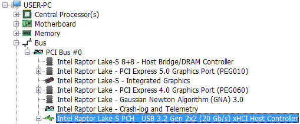

Example of how to identify your xHCI controller using HWiNFO

- [Click latencies of various mice](https://pbs.twimg.com/media/EssHosLW8AEeWmB?format=png&name=medium)
- [Impact of RGB on mouse performance](https://www.techpowerup.com/review/endgame-gear-xm1-rgb/5.html)
- [Impact of DPI and polling rate on latency](https://i.imgur.com/0GKQBIf.png) Source: [Battle(non)sense: Razer Viper 8k Delay Analysis](https://youtu.be/mwf_F2VboFQ)
- [Wired vs. wireless latency](https://i.imgur.com/rihmhRJ.png) Source: [Battle(non)sense: Cut the Cord? Wired vs. Wireless vs. Bluetooth](https://youtu.be/Zn7WjyIvAWA)
- [X570 chipset diagram](https://www.gamersnexus.net/images/media/2019/news/amd/x570-chipset-block-diagram.jpg)
- Since Ryzen CPUs have on-die USB; make sure your mouse and keyboard are connected directly to the CPU’s controller, as opposed to the chipset’s . You can test your polling using [MouseTester](https://github.com/valleyofdoom/MouseTester/releases) to verify; the grouping will be much tighter on your CPU’s xHCI controller

Lower latency mice:

- [Endgame Gear OP1 8k v2](https://amzn.to/4wVZPtj) (8KHz, 50g, PAW3399 sensor)
- [Razer Viper V4 Pro](https://amzn.to/4eb6sAv) (8kHz, 59g, Focus Pro 50K, wireless)
- [Razer DeathAdder V3 Wired](https://amzn.to/46zpue1) (8KHz, 59g, PAW3950 sensor, ergonomic shape)
- [Zaunkoenig M3K](https://zaunkoenig.co/) (8KHz, 24g, 3399 sensor)
- Avoid Finalmouse, Glorious, and Zowie
- [RTINGS table tool](https://www.rtings.com/mouse/tools/table/115151) (sorted by wired click latency)
- [TechPowerUp/pzogel’s mouse reviews](https://www.techpowerup.com/review/?category=Mice) (click and motion latency tested)

Monitors:

Monitors have many sources of latency, starting from the GPU’s output to the display itself. CRTs have very low latency because less signal processing is required, and the near instantaneous response times of CRT technology (once the signal is converted to analog, a CRT’s latency is essentially the refresh rate), [whereas LCDs have multiple components](http://monitorinsider.com/monitor_anatomy/) such as the scaler, timing controller, source drivers, TFT, and each have their own delays. 1920x1080 is still the competitive standard as minimum latency increases because of the additional rendering cost (e.g. 1920x1080→2650x1440 = 77.78% increase in pixels). Another thing to keep in mind is that higher refresh rate displays inherently have lower scanout latency than their lower refresh counterparts. For example, a 360Hz monitor will be faster at 120 FPS than a 240Hz monitor, all else equal, because the 360Hz monitor is scanning out 120 times per second more.

- [Input lag comparison of different refresh rates while capped at 120 FPS (display scanout latency)](https://x.com/CaIypto/status/1836081466473664672)

I will only cover 360Hz+ monitors since CRTs are no longer in production. The latency can be split into two categories: processing and pixel response time. Processing is the delay of the monitor processing the signal, whereas response time is how quickly the pixel can change states (manifests as motion blur). An example below shows the separation of the processing and response time latencies. Note that this selection of monitors is very limited, so don’t base your monitor purchase off a single source. Avoid monitors with [PWM (pulse-width modulation)](https://www.notebookcheck.net/Why-Pulse-Width-Modulation-PWM-is-such-a-headache.270240.0.html) at all costs, even if high frequency. Amazon Renewed monitors are often much cheaper than brand new monitors while only having damaged packaging. It is worthwhile as you can save a lot of money and have a 30 day return policy if you are not content. Higher overdrive is lower latency, so set it as high as you can tolerate. Black frame insertion (e.g. DyAc, ELMB, etc.) increases latency and introduces flicker which causes eye strain. Therefore, BFI is not a substitute for having a panel with good response times.

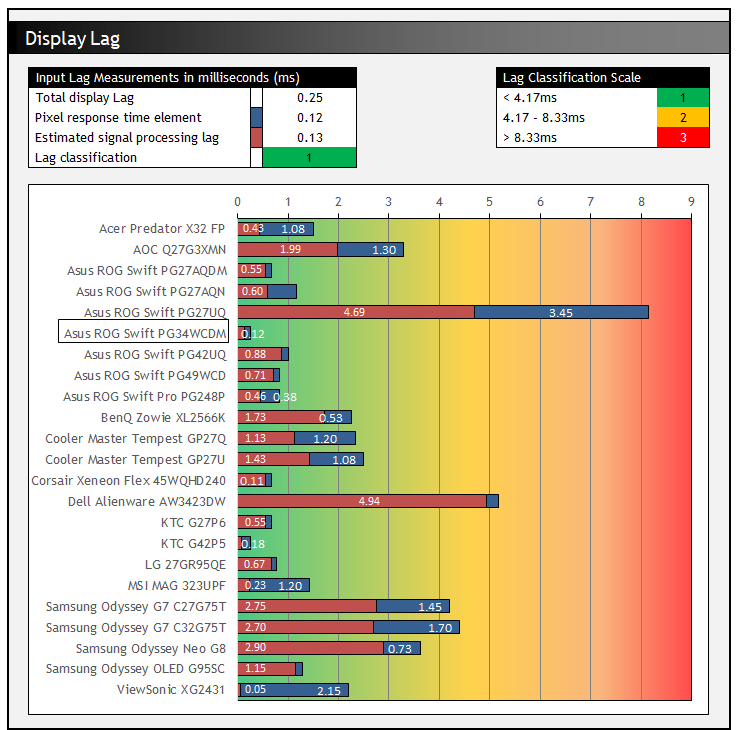

Source: https://tftcentral.co.uk/reviews/asus-rog-swift-pg34wcdm#Lag

Also, ensure you cap your game’s FPS to your monitor’s refresh rate (or any integer multiple/factor) if not using variable refresh rate (adaptive sync). If you cap your FPS improperly, there will be a beat frequency which can be observed as stuttering. For example, if you have a 240Hz monitor, cap your game to 240 FPS, or even 120 or 480 FPS depending on what you can steadily hold. An example of an improper cap would be 240Hz / 237FPS because these numbers do not evenly go into each other. If variable refresh rate is not enabled, this will cause 3 stutters per second. 240Hz / 250FPS would cause 10 stutters per second, and so on. Once the cap is properly set, and the frame limiter is accurate (generally game engine limiters have awful accuracy), the tear line should stay in one location (stuttering/microstuttering or a bad limiter will cause it to wander). One thing to keep note of is default resolutions that monitors ship with may use an offset of 0.1% for the vertical refresh frequency (59.94Hz, 239.76Hz, etc.), so you will need to adjust it in [CRU](https://www.monitortests.com/forum/Thread-Custom-Resolution-Utility-CRU) to make sure the refresh rate is an integer, otherwise the cap will have a rolling tear line. Alternatively, use variable refresh rate (FreeSync / G-Sync) and cap the FPS to around 10% lower than your monitor’s maximum refresh rate (e.g. 360Hz * 0.90 = 324FPS cap - this is to account for jitter in FPS limiters and general performance variation, which manifests as microstuttering). Do note that variable refresh rate adds delay compared to fixed refresh rate:

- [Input lag comparison of various FPS limiter configurations on an Nvidia GPU in a Reflex-enabled game (Overwatch 2)](https://x.com/CaIypto/status/1953382235593228516)

Keep in mind most IPS panels (360Hz+) have poor refresh rate compliance (<90%), meaning the response times are not fast enough to completely transition within the refresh window (e.g. 2.77ms @ 360Hz). The TN models have much faster response times, but also have high processing lag (such as the [Asus 540Hz](https://www.techspot.com/review/2763-asus-rog-swift-pro-pg248qp/) having 1ms processing lag).

OLED gaming monitors have excellent response times and processing lag but have many undesirable, inherent characteristics such as flicker, bad subpixel layout (not RGB stripe), high burn-in risk, vertical/horizontal banding, and “dirty screen” effect. The decision is up to you whether these trade-offs are worth the fast response times. LG’s WOLED is seemingly more prone to dirty screen and banding, while Samsung’s QD-OLED is seemingly less so. Upcoming panels from both LG and Samsung will use RGB stripe. Below is an image example dirty screen and banding:

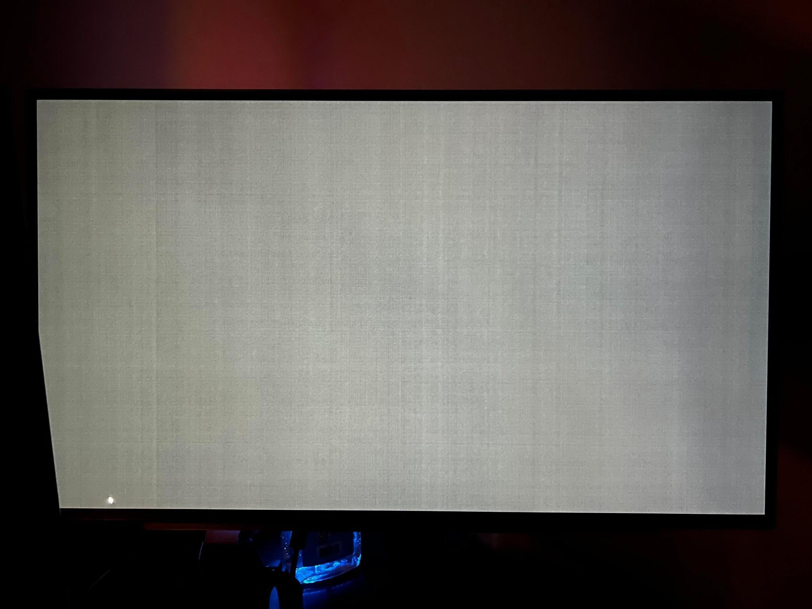

Source: https://old.reddit.com/r/OLED_Gaming/comments/1748uv6/new_to_oled_dirty_screen_effects_grey_uniformity/

(More examples here: https://www.google.com/search?udm=2&q=oled+dirty+screen+effect)

- https://www.rtings.com/monitor/learn/woled-vs-qd-oled

Some of the newer high resolution, high refresh rate monitors (e.g. 1440p 480Hz) use under-specced display connectors which require the use of Display Stream Compression (DSC), which is a “visually lossless” compression method to reduce bandwidth. It allows for underpowered connectors such as DisplayPort 1.4 / HDMI 2.1 to run at resolutions and refresh rates which would otherwise be impossible without DSC. However, it can / will introduce a few issues such as: slow alt-tab times, no DSR/DLDSR, each DSC display counting as two displays (the limit is four), and no multiplane overlay (MPO) support. If you want to avoid running into these issues, wait for DisplayPort 2.1 UHBR20 capable displays and graphics cards. On RTX 5000-series GPUs, these issues are mostly alleviated as the bandwidth for the internal display heads was increased, no longer requiring two heads for a single display (assuming the new bandwidth limit isn’t reached).

480Hz 1440p (WOLED):

- [Asus PG27AQDP](https://amzn.to/4eMCCAn) ( [TFTCentral](https://tftcentral.co.uk/reviews/asus-rog-swift-pg27aqdp) )
- Beware of the stupid ROG monitor stand which wastes space
- Displayport 1.4 (DSC)
- [LG 27GX790A-B](https://amzn.to/3PJLkIn)
- Slightly cheaper than the ASUS version with a non-retarded stand

500Hz 1440p (QD-OLED):

- [MSI MAG 272QP QD-OLED X50](https://amzn.to/4uBnttp)
- Much better than Samsung’s own version where the joystick disintegrates after a few uses
- DisplayPort 1.4a (DSC)

540Hz 1440p / 720Hz 720p (WOLED):

- LG’s fourth generation WOLED; “Tandem OLED”
- RGB pentile subpixel layout (not RGB stripe)
- [LG 27GX790B-B](https://amzn.to/40JMBkl)
- Only UHBR 13.5
- No option to disable pixel shift unlike the previous generation 480Hz
- [Asus PG27AQWP-W](https://amzn.to/4l6CShs) ( [TFTCentral](https://tftcentral.co.uk/reviews/asus-rog-swift-pg27aqwp-w) )
- UHBR20 (can run without DSC with a capable GPU)
- Awful stand

Monitor review sites with latency measurements (do not compare measurements from different sources due to differing test methods)

https://www.tftcentral.co.uk/reviews.htm

https://www.rtings.com/monitor/reviews

https://pcmonitors.info/reviews/archive/

https://www.youtube.com/@monitorsunboxed/videos

https://www.youtube.com/@techlessYT/videos

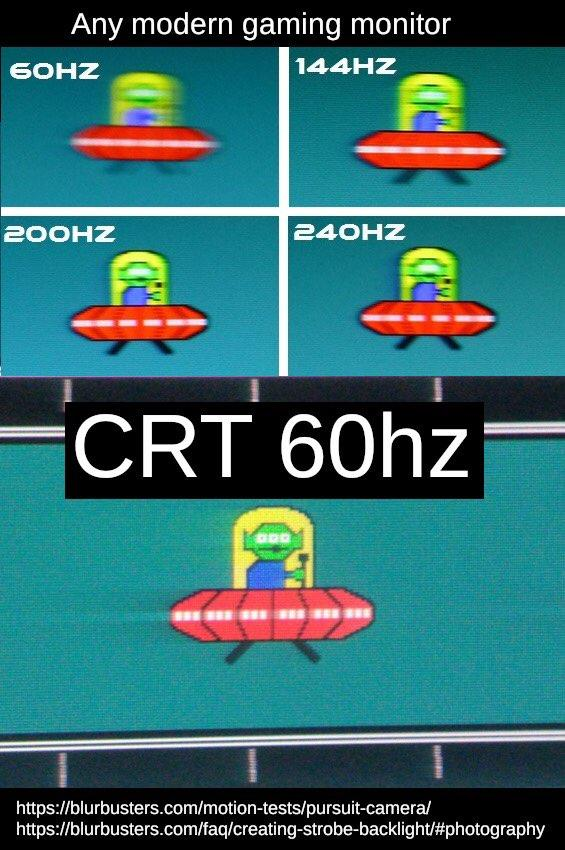

## Miscellaneous links

Windows ISOs (verify integrity before installing: https://www.heidoc.net/php/myvsdump.php)

- https://msdl.gravesoft.dev/ (8.1-11)
- https://tb.rg-adguard.net/public.php (8.1 - 11)
- https://docs.google.com/spreadsheets/d/1zTF5uRJKfZ3ziLxAZHh47kF85ja34_OFB5C5bVSPumk/ (XP - 10 21H1)
- https://files.dog/MSDN/ (XP, Vista, 7, 8, 8.1, 10 1511/1607)
- https://uupdump.net/ (Most Windows 10/11 builds, however the process to get an .iso file is convoluted compared to the other sources)
- https://massgrave.dev/genuine-installation-media.html (XP-11, Server 2016-2025)
- https://os.click/ (XP-11)

Windows activation

- https://massgrave.dev/ / https://github.com/massgravel/Microsoft-Activation-Scripts/
- Windows 7 Ultimate GPT/UEFI: https://github.com/Dir3ctr1x/EzWindSLIC

Windows 7 driver integration

Windows 7 does not have xHCI (USB 3) and NVMe drivers, which will prevent you from installing on modern hardware. Use these resources to get around the limitations. See “[Integration of drivers into a Win7/8/10 image](https://www.win-raid.com/t750f25-Guide-Integration-of-drivers-into-a-Win-image.html)” on how to use NTLite to integrate the drivers and updates listed below, then use [Ventoy](https://www.ventoy.net/en/index.html) to put the .iso NTLite creates onto a flash drive. With Ventoy you can choose between UEFI/CSM boot without having to specifically flash as either mode. In your motherboard’s UEFI, CSM should be enabled and secure boot disabled to boot into Windows 7 on UEFI-based systems (these options are located in your motherboard’s UEFI, typically under “Boot”). There are workarounds listed for this below if you want Windows 7 without CSM (Resizable BAR requires UEFI+GPT; no MBR or CSM). In NTLite, be sure to integrate the updates and drivers into install.wim and boot.wim for PE as well in case recovery will be needed.

- [Generic USB 3 driver](https://forums.mydigitallife.net/threads/usb-3-xhci-driver-stack-for-windows-7-vista.81934/) - supports 8KHz polling natively ( [backup link](https://www.mediafire.com/file/h8zjqo8mxmppm5n) / pass: MDL2021)
- Requires [KB2864202](https://www.catalog.update.microsoft.com/Search.aspx?q=KB2864202)
- [Z370 USB+NVMe iso integration tool](http://download.gigabyte.eu/FileList/Utility/mb_utility_windowsimagetool_B18.0213.1.zip)
- [Z390 USB driver](https://drive.google.com/file/d/1akxmt_B382SJ8JwRoMataazTmOfzRt6d/view?usp=sharing) - from [canonkong](https://www.win-raid.com/t4883f52-Solution-Win-drivers-for-USB-Controllers-of-new-Intel-chipset-systems.html) - requires [IMOD change](https://djdallmann.github.io/GamingPCSetup/CONTENT/RESEARCH/PERIPHERALS/) for 2KHz+
- [Z490 USB driver](https://drive.google.com/file/d/120f1o_kxV-wF0Ax13yJxkUzsyBsDNU6D/view?usp=sharing) - from m0nkrus, [NewcomerAl](https://www.win-raid.com/t4883f52-Solution-Win-drivers-for-USB-Controllers-of-new-Intel-chipset-systems-18.html#msg111959) - requires [IMOD change](https://djdallmann.github.io/GamingPCSetup/CONTENT/RESEARCH/PERIPHERALS/) for 2KHz+
- [Intel](https://www.biostar.com.tw/app/en/event/H310_windowstool/win7_8th_i3_i5_Driver_2.0.rar) [UHD](https://www.biostar.com.tw/app/en/event/H310_windowstool/win7_8th_i3_i5_Driver_2.0.rar) [630 driver](https://www.biostar.com.tw/app/en/event/H310_windowstool/win7_8th_i3_i5_Driver_2.0.rar) , [modded+signed driver](https://forum.ixbt.com/topic.cgi?id=58:5107:289#289)
- [Intel I219-V driver](https://downloadmirror.intel.com/18713/eng/PROWinx64Legacy.exe)
- [Intel I225-V driver](https://drive.google.com/file/d/1HaDiZzJkU6SRiSQI4F1KLwPTfkPlycTN/view?usp=sharing) - from [canonkong](https://www.win-raid.com/t7402f42-Installing-i-v-ethernet-drivers-W-drivers-on-windows.html) [and daniel_k](https://www.win-raid.com/t7402f42-Installing-i-v-ethernet-drivers-W-drivers-on-windows.html)
- [Realtek 2.5G driver](https://www.realtek.com/en/component/zoo/category/network-interface-controllers-10-100-1000m-gigabit-ethernet-pci-express-software)
- [Generic NVMe driver](https://drive.google.com/file/d/1NMTu8aZXXVdOAHOu7U6_q--Id9_-pmZl/view?usp=sharing) (This archive contains updates [KB2990941](https://support.microsoft.com/en-us/kb/2990941) and [KB3087873](http://download.windowsupdate.com/d/msdownload/update/software/htfx/2015/09/windows6.1-kb3087873-v2-x64_098e3dc3e7133ba8a37b2e47260cd8cba960deb8.msu) which add NVMe support)
- Warning : I highly discourage use of this driver post install due to very poor performance; install the [modded+signed Samsung driver](https://mega.nz/#!00pVkQLJ!NqJwjtrr_pRhyjaUB4jXXbxbgvhCaB62uGFGUfVOxek) from [Fernando](https://winraid.level1techs.com/t/recommended-ahci-raid-and-nvme-drivers/28310) afterwards
- [Other storage drivers](https://www.win-raid.com/t29f25-Recommended-AHCI-RAID-and-NVMe-Drivers.html) (NVMe, SATA AHCI/RAID)
- [Normal UEFI Installation](https://github.com/BoringBoredom/PC-Optimization-Hub/blob/main/content/multi-booting/multi-booting.md#how-to-multi-boot-windows-7-10-in-uefi-mode-on-a-single-drive) (use this method if unsure), UEFI Class 3 installation: https://github.com/manatails/uefiseven
- [Bypass Windows 7 Extended Security Updates Eligibility](https://forums.mydigitallife.net/threads/bypass-windows-7-extended-security-updates-eligibility.80606/) (allows Extended Security Updates to be installed)
- After installing BypassESU AIO you can install [KB5017361](https://www.catalog.update.microsoft.com/Search.aspx?q=KB5017361) which adds [native UEFI+Secure Boot support](https://github.com/vxiiduu/VxKex/issues/41)

Recommended updates:

- [KB2864202](https://www.catalog.update.microsoft.com/Search.aspx?q=KB2864202) Security Update for Kernel-Mode Driver Framework (KMDF) version 1.11 (required for the backport xHCI driver)
- [KB4474419](https://catalog.update.microsoft.com/search.aspx?q=kb4474419) SHA-2 code signing support
- [KB4490628](https://catalog.update.microsoft.com/search.aspx?q=4490628) Servicing stack update

On top of integrating drivers/updates, these UEFI settings are required for a MBR-based Windows 7 installation:

- Enable: CSM (compatibility support module)
- Disable: Secure boot
- Disable: Above 4G decoding
- Disable: Resizable BAR

Stress testing software for overclocking

RAM:

- HCI: https://hcidesign.com/memtest/ [MemTestHelper](https://github.com/integralfx/MemTestHelper)
- Karhu: https://www.karhusoftware.com/ramtest/
- OCCT: https://www.ocbase.com/download
- Prime95 large FFTs: https://www.mersenne.org/download/
- TM5: https://testmem.tz.ru/testmem5.htm [extreme@anta777 config](https://drive.google.com/file/d/1uegPn9ZuUoWxOssCP4PjMjGW9eC_1VJA/edit)
- y-cruncher: http://www.numberworld.org/y-cruncher/
- RAM Test Pro: https://pcstonks.com/en/ram-test-pro

CPU:

- FIRESTARTER: https://github.com/tud-zih-energy/FIRESTARTER
- Linpack Extended: https://github.com/BoringBoredom/Linpack-Extended (primarily intended for Intel systems)
- Prime95 small FFTs: https://www.mersenne.org/download/
- y-cruncher: http://www.numberworld.org/y-cruncher/

Bootable:

- https://github.com/valleyofdoom/StresKit
- https://www.memtest86.com/ (extremely inefficient at catching errors, but good enough to check if you won’t instantly corrupt your OS upon boot)

Why latency matters

https://www.youtube.com/watch?v=vOvQCPLkPt4 - “Applied Sciences Group: High Performance Touch”

https://www.youtube.com/watch?v=kJDvi1kcvAI - “System Latency Impacts Peeker's Advantage”

https://www.youtube.com/watch?v=kLie-FdDhSA - “System Latency Impacts Hit Registration”

https://www.nvidia.com/en-us/geforce/news/reflex-low-latency-platform/#so-what-is-latency-anyway

https://ibb.co/BwCS3XR - “Why E-Sports Is Nothing but Pay2Win, Takes No Skill Whatsoever and Has No Value at All” by Adam

A slightly better way to overclock and tweak your Nvidia GPU

https://docs.google.com/document/d/14ma-_Os3rNzio85yBemD-YSpF_1z75mZJz1UdzmW8GE/edit

Collection of various resources devoted to performance and input lag optimization

https://github.com/BoringBoredom/PC-Optimization-Hub

A highly structured & technical hardware, BIOS & Windows optimization guide dedicated for performance, privacy & latency enthusiasts.

https://github.com/valleyofdoom/PC-Tuning

Gaming PC Setup for Windows 10 v2004

https://djdallmann.github.io/GamingPCSetup/

r0ach’s BIOS optimization guide

https://www.overclock.net/forum/6-intel-motherboards/1433882-gaming-mouse-response-bios-optimization-guide-modern-pc-hardware.html

Optimizing Computer Applications for Latency: Part 1: Configuring the Hardware

https://software.intel.com/en-us/articles/optimizing-computer-applications-for-latency-part-1-configuring-the-hardware

Fujitsu Primergy Server BIOS Settings for Performance, Low-Latency and Energy Efficiency

https://sp.ts.fujitsu.com/dmsp/Publications/public/wp-bios-settings-primergy-ww-en.pdf

Better HyperThreading/SMT explanation

https://web.archive.org/web/20191127071243/http://www.cs.virginia.edu/~mc2zk/cs451/vol6iss1_art01.pdf

Collection of airflow-oriented computer cases

https://docs.google.com/spreadsheets/d/14Kt2cAn8a7j2sGXiPGt4GcxpR3RXVcDAx9R5c2M8680/edit?usp=sharing

Collection of high-performance fans

https://docs.google.com/spreadsheets/d/1AydYHI_M6ov9a3OgVuYXhLEGps0J55LniH9htAHy2wU/edit?usp=sharing

Follow me on Twitter

https://twitter.com/CaIypto

If you found the contents of this guide useful and would like to donate, you can do so here

https://www.paypal.com/donate/?hosted_button_id=UQJE6DZ9RX3KQ


