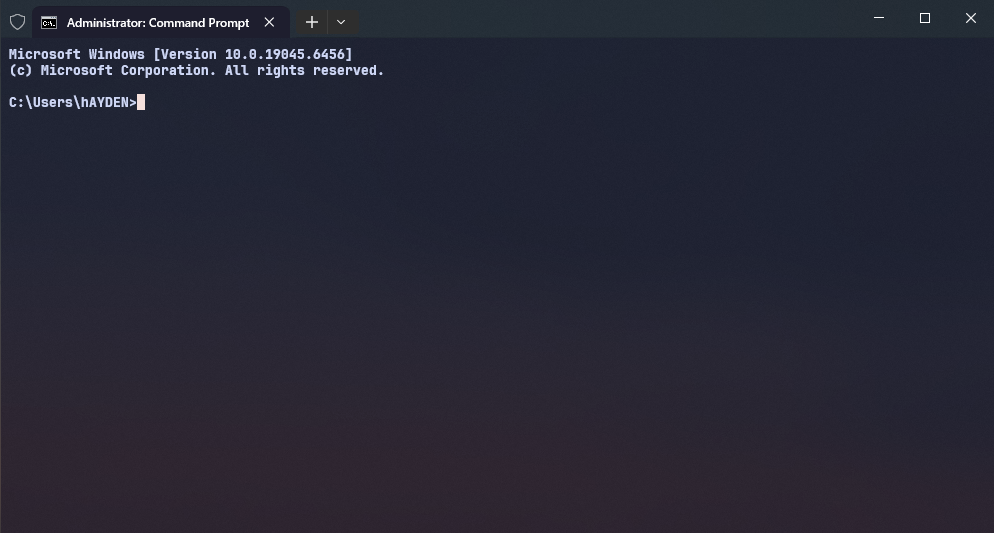

# Windows Terminal

Тема Catppuccin Mocha, шрифт JetBrainsMono Nerd Font, прозрачность 80%.



## Установка одной командой

Открой PowerShell (Win+X → «Терминал») и вставь:

```powershell
irm "https://raw.githubusercontent.com/Hayden-Wright/Setup/main/%D0%9A%D0%BE%D0%BD%D1%84%D0%B8%D0%B3%D0%B8/Windows%20Terminal/install.ps1" -OutFile $env:TEMP\wt-setup.ps1; & $env:TEMP\wt-setup.ps1
```

Больше ничего делать не нужно: скрипт сам поставит Windows Terminal и шрифт
(если их нет), сделает бэкап старого `settings.json` и положит настройки.
В конце напишет `Готово.`

## Что именно он делает

1. **Ищет Windows Terminal.** Если не находит — ставит через `winget`.
2. **Ищет шрифт** `JetBrainsMono Nerd Font` в реестре. Если нет — ставит
   пакет `DEVCOM.JetBrainsMonoNerdFont` через `winget`.
3. **Делает бэкап** текущего `settings.json` рядом с ним:
   `settings_backup_ГГГГ-ММ-ДД_ЧЧ-ММ-СС.json`.
4. **Кладёт настройки**: тема Catppuccin Mocha, прозрачность 80%,
   шрифт JetBrainsMono Nerd Font Mono, свои горячие клавиши.

Терминал при этом **не закрывается**. В отличие от Sublime Text, он не
перезапишет настройки при выходе — он следит за `settings.json` и
перечитывает его на лету, так что изменения видны сразу.

## Как проверить, что всё получилось

Открой Windows Terminal и посмотри:

- **Тема.** Фон тёмно-синий с прозрачностью, а не чёрный. Если фон чёрный —
  настройки не встали.
- **Шрифт.** `Ctrl+Shift+,` → «Открыть файл JSON»: в `font.face` должно быть
  `JetBrainsMono Nerd Font Mono`. Если Terminal не нашёл шрифт, он молча
  подставит свой — тогда поставь шрифт и перезапусти терминал.
- **Прозрачность.** Видно обои сквозь фон. Если нет — проверь, что в
  параметрах Windows включены эффекты прозрачности.

## Если что-то пошло не так

**`irm` не распознан / команда не найдена.**
Ты в старой командной строке (`cmd.exe`) вместо PowerShell. Открой именно
PowerShell: Win+X → «Терминал», или `Win+R` → `powershell`.

**«выполнение сценариев отключено в этой системе».**
Разреши запуск для текущего пользователя и повтори команду:

```powershell
Set-ExecutionPolicy -Scope CurrentUser RemoteSigned
```

**Шрифт поставился, но Terminal его не видит.**
Шрифты подхватываются при запуске приложений. Полностью закрой Terminal
(все окна) и открой заново.

**Не ставится Windows Terminal** (нет winget или Microsoft Store).
Поставь вручную: https://aka.ms/terminal

**Хочу откатить всё назад.**
Скопируй `settings_backup_...json` поверх `settings.json` рядом с ним.

## Установка из клона репозитория

Если репозиторий уже склонирован, интернет не нужен — скрипт возьмёт
`settings.json` из папки рядом с собой:

```powershell
cd "путь\к\Setup\Конфиги\Windows Terminal"
.\install.ps1
```

## Вручную, без скрипта

1. Поставить [JetBrainsMono Nerd Font](https://github.com/ryanoasis/nerd-fonts/releases/latest/download/JetBrainsMono.zip) — распаковать и установить `.ttf`.
2. В терминале `Ctrl+Shift+,` → «Открыть файл JSON».
3. Заменить содержимое на [settings.json](settings.json), сохранить.

## Файлы

| Путь | Что это |
|---|---|
| `settings.json` | тема, шрифт, прозрачность, горячие клавиши |
| `install.ps1` | установщик |
| `screenshot.png` | как это выглядит |

