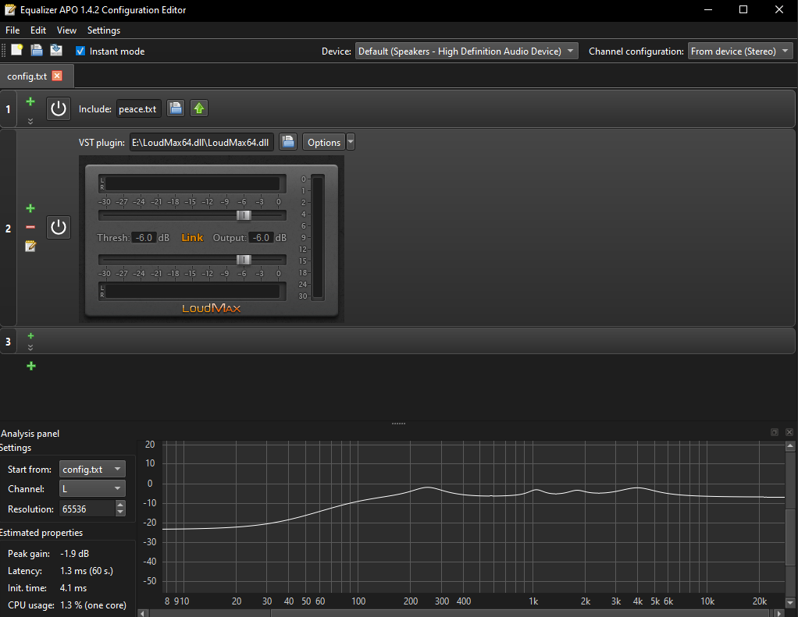
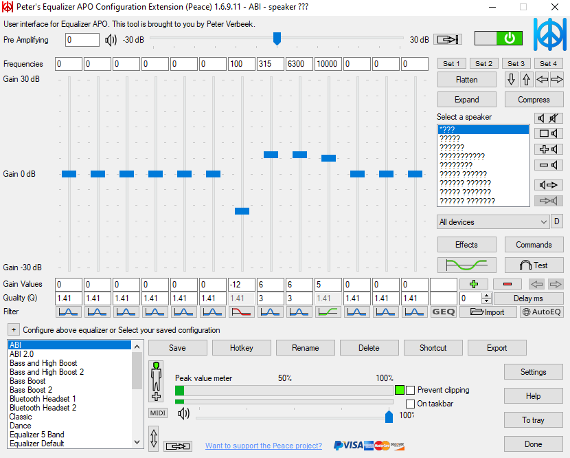

Пресеты для Peace. В конце цепочки — лимитер LoudMax.

## Поставить

- **[Equalizer APO](https://sourceforge.net/projects/equalizerapo/)** — при установке отметить устройство вывода, потом перезагрузиться
- **[Peace](https://sourceforge.net/projects/peace-equalizer-apo-extension/)** — ставится после APO
- **[LoudMax](https://loudmax.blogspot.com/2026/06/loudmax-plugin-v147-released.html)** — лимитер, архив **VST2 for Windows**

## Пресет

Peace → `Import` → `.peace` из репозитория → `Save` → `Done`.

## Лимитер

`LoudMax64.dll` из архива — в любую папку, потом не перемещать. Configuration
Editor (`config.txt`) → `+` → **VST plugin** → путь к dll → `Options` →
`Thresh` −6 dB, `Output` −6 dB, `Link`.

## Пресет 1

| Частота | Тип | Gain | Q |
|---|---|---|---|
| 100 Hz | low shelf | −12 dB | 1.41 |
| 315 Hz | peak | +6 dB | 3 |
| 6300 Hz | peak | +6 dB | 3 |
| 10000 Hz | high shelf | +5 dB | 1.41 |

## Пресет 2

| Частота | Тип | Gain | Q |
|---|---|---|---|
| 70 Hz | low shelf | −12 dB | 0.93 |
| 250 Hz | peak | +4.5 dB | 1.76 |
| 1050 Hz | peak | +3 dB | 3.5 |
| 1800 Hz | peak | +2.5 dB | 3 |
| 4000 Hz | peak | +4.5 dB | 1.43 |

Тип — в строке `Filter` под ползунком (`LS` / `PK` / `HS`), Gain и Q — под
графиком.
